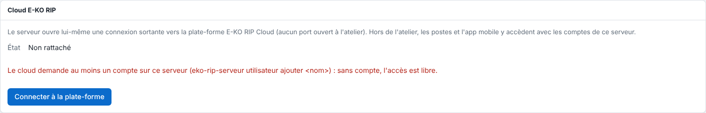

Le serveur affiche « Le cloud demande au moins un compte sur ce serveur » quand vous tentez de le relier.
C'est une protection : sans compte, l'accès au serveur est libre sur le réseau local.

## Avant de commencer

- Vous êtes à l'atelier, connecté au serveur en administrateur.
- Le message s'affiche dans **Système › Cloud E-KO RIP**.

  

## Étapes

1. Créez un compte utilisateur sur le serveur. Voir [Créer les comptes du serveur](../rip-administration/rip-creer-les-comptes.md).
2. Revenez dans **Système › Cloud E-KO RIP** : le message disparaît.
3. Cliquez sur **Connecter à la plate-forme** pour obtenir un code.
4. Poursuivez le rattachement. Voir [Relier un serveur RIP au cloud](../rip-cloud-premiers-pas/rip-cloud-relier-un-serveur.md).

## Bon à savoir

- Sur le serveur, la commande `sudo eko-rip-serveur utilisateur ajouter <nom>` crée aussi un compte.
- Le serveur refuse aussi, par prudence, toute demande venue par le cloud tant qu'aucun compte n'existe (code `cloud_sans_compte`).
- Une fois le serveur relié, les comptes utilisés à distance sont ceux du serveur RIP.

## Voir aussi

- [Créer les comptes du serveur](../rip-administration/rip-creer-les-comptes.md)
- [Relier un serveur RIP au cloud](../rip-cloud-premiers-pas/rip-cloud-relier-un-serveur.md)
- [Résoudre un code de rattachement expiré ou refusé](rip-cloud-code-expire.md)
