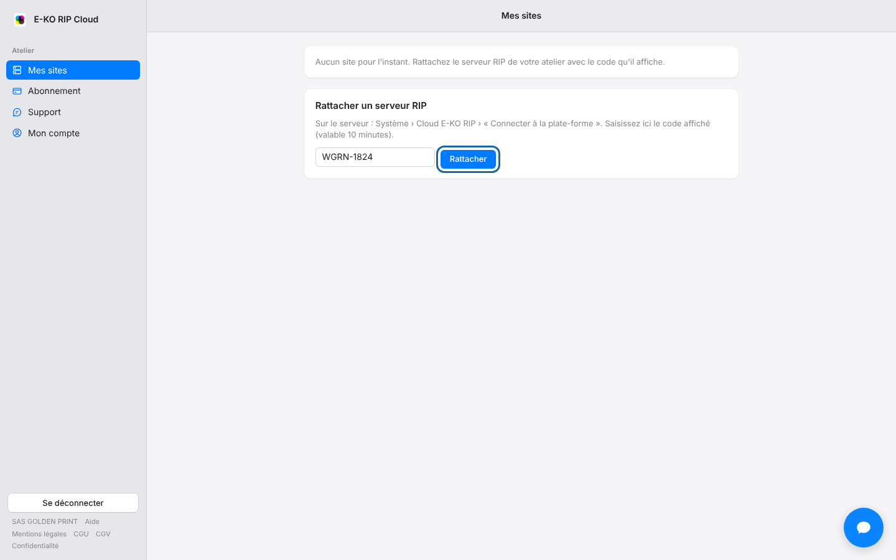

Le code de rattachement n'est valable que 10 minutes.
Un nouveau code règle la plupart des refus.

## Avant de commencer

- Vous êtes à l'atelier, connecté au serveur RIP en administrateur.
- L'adresse e-mail de votre compte de la plate-forme doit être confirmée.

## Étapes

1. Ouvrez **Système › Cloud E-KO RIP** sur le serveur.
2. Cliquez de nouveau sur **Connecter à la plate-forme** pour obtenir un nouveau code.
3. Saisissez-le dans **Mes sites** puis cliquez sur **Rattacher**.

## Bon à savoir

- Si le portail refuse toujours, confirmez votre adresse e-mail.
- Si le cloud ne s'ouvre pas à cause du message « au moins un compte », créez d'abord un compte sur le serveur RIP, puis recommencez.

## Voir aussi

- [Relier un serveur RIP au cloud](../rip-cloud-premiers-pas/rip-cloud-relier-un-serveur.md)
- [Confirmer son adresse e-mail](../rip-cloud-premiers-pas/rip-cloud-confirmer-adresse-email.md)
- [Documentation du cloud](https://e-ko.rip/documentation/cloud/)
