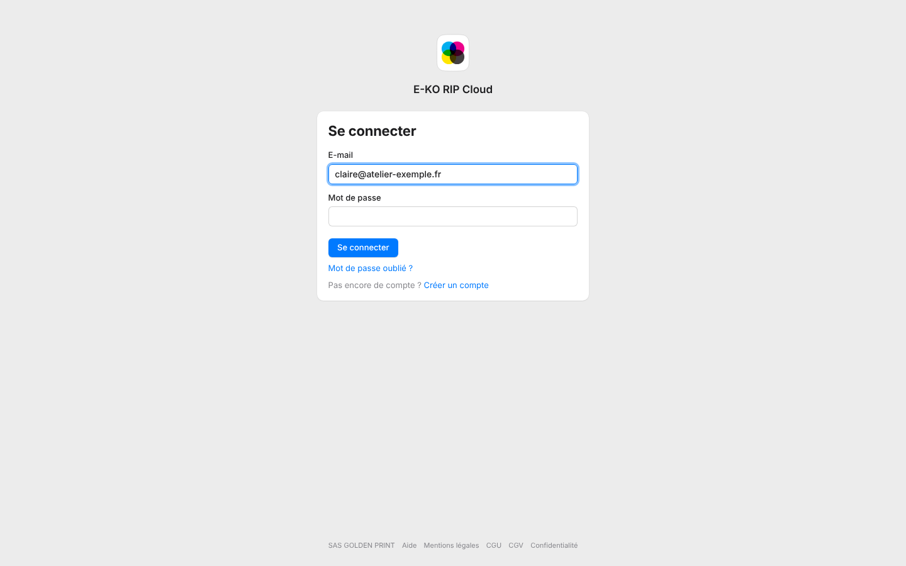

Après 5 mots de passe faux de suite, le compte est bloqué pendant 5 minutes.
C'est une protection contre les essais répétés.

## Avant de commencer

- Ne multipliez pas les essais : chaque échec prolonge l'attente.
- Si vous ne vous souvenez plus du mot de passe, passez directement à la réinitialisation.

## Étapes

1. Attendez 5 minutes sans réessayer.
2. Reconnectez-vous avec le bon mot de passe.
3. Si vous l'avez oublié, cliquez sur **Mot de passe oublié ?** sur la page de connexion. Voir [Réinitialiser un mot de passe oublié](../rip-cloud-compte/rip-cloud-mot-de-passe-oublie.md).

   

## Bon à savoir

- Ce blocage concerne le compte de la plate-forme. Les comptes du serveur RIP ont leur propre protection : voir [Se connecter au serveur depuis un poste](../rip-premiers-pas/rip-se-connecter-au-serveur.md).
- Des limites par adresse s'appliquent aussi aux inscriptions et aux connexions.
- Un compte suspendu ne se connecte plus : contactez le support.
- Si vous vous connectez avec Google ou Facebook, aucun mot de passe de la plate-forme n'est demandé.

## Voir aussi

- [Réinitialiser un mot de passe oublié](../rip-cloud-compte/rip-cloud-mot-de-passe-oublie.md)
- [Résoudre un lien expiré ou invalide](rip-cloud-lien-expire.md)
- [Joindre le support en direct](rip-cloud-joindre-le-support.md)
