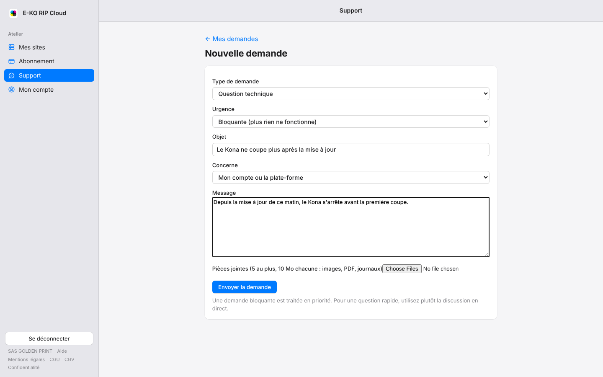
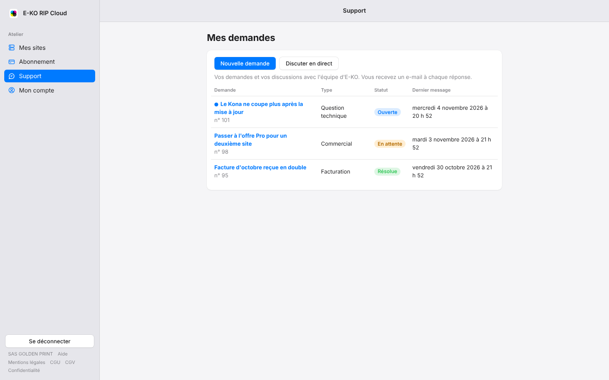
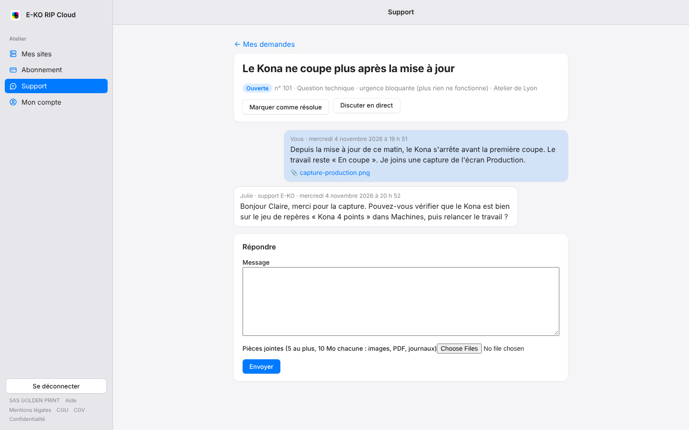

La page **Support** du portail regroupe vos demandes écrites à l'équipe d'E-KO. Une demande
garde tout l'historique d'un sujet : vos messages, les réponses, les pièces jointes et son
statut. Pour une question rapide, la discussion en direct reste plus simple.

## Avant de commencer

- Connectez-vous au portail avec votre compte.
- Préparez ce qui aide l'équipe à comprendre : une capture de l'écran, le journal du serveur
  RIP, le nom du site et de la machine concernés.

## Étapes

Pour ouvrir une demande :

1. Cliquez sur **Support** dans la barre latérale, puis sur **Nouvelle demande**.
2. Choisissez le **Type de demande** : Question technique, Facturation, Commercial ou Autre.
3. Choisissez l'**Urgence** :
   - **Normale** pour la plupart des questions ;
   - **Haute** si une partie de la production est gênée ;
   - **Bloquante** si plus rien ne fonctionne. Ces demandes sont traitées en priorité.
4. Écrivez un **Objet** court, par exemple « Le Kona ne coupe plus après la mise à jour ».
5. Dans **Concerne**, choisissez le site visé, votre compte, votre abonnement, ou **Autre**.
6. Décrivez le problème dans **Message** : ce que vous faisiez, ce qui s'affiche, depuis quand.
7. Ajoutez au besoin des **Pièces jointes**, puis cliquez sur **Envoyer la demande**.

La demande s'ouvre aussitôt : son numéro s'affiche à côté du statut. Rappelez-le si vous
écrivez à l'équipe à son sujet.

## Voir ses demandes

1. Cliquez sur **Support** dans la barre latérale. La page **Mes demandes** s'ouvre.
2. Chaque ligne montre l'objet de la demande, son numéro, son type, son statut et la date du
   dernier message.
3. Un point bleu devant l'objet signale une réponse que vous n'avez pas encore lue.

Les statuts possibles :

| Statut | Ce qu'il veut dire |
|---|---|
| Ouverte | L'équipe traite la demande. |
| En attente | L'équipe attend une réponse ou une information de votre part. |
| Résolue | La demande est close. Une nouvelle réponse de votre part la rouvre. |

## Lire les réponses et répondre

1. Sur **Mes demandes**, cliquez sur l'objet de la demande.
2. Le fil montre vos messages à droite et ceux de l'équipe à gauche, avec le prénom de la
   personne qui vous répond. Cliquez sur une pièce jointe pour la télécharger.
3. Pour répondre, écrivez dans **Répondre**, ajoutez au besoin des pièces jointes, puis cliquez
   sur **Envoyer**.

## Clore une demande

Quand le problème est réglé, ouvrez la demande et cliquez sur **Marquer comme résolue**. Si le
problème revient, répondez simplement dans la même demande : elle repasse en **Ouverte**.

## Bon à savoir

- **Pièces jointes** : 5 fichiers au plus par message, 10 Mo chacun. Sont acceptés les images
  (PNG, JPEG, GIF, WebP, HEIC), les PDF, les journaux (`.log`, `.txt`, `.json`) et les archives
  `.zip`.
- **E-mails** : à chaque réponse de l'équipe, vous recevez l'e-mail « Nouvelle réponse à votre
  demande n° … » avec un lien vers la demande. Le texte de la réponse n'est pas recopié dans
  l'e-mail : il se lit sur le portail. Un autre e-mail vous prévient quand la demande passe en
  **Résolue**.
- **Confidentialité** : vous ne voyez que les demandes de votre compte. Les échanges internes de
  l'équipe n'apparaissent jamais.
- **Discuter en direct** ouvre la bulle du support pour une question rapide. Les discussions de
  la bulle apparaissent aussi dans **Mes demandes**.
- Si la liste affiche « Le support est momentanément injoignable », réessayez quelques minutes
  plus tard, ou écrivez dans la bulle.

## Voir aussi

- [Joindre le support en direct](rip-cloud-joindre-le-support.md)
- [Retrouver une ancienne demande de support](rip-cloud-ancienne-demande-de-support.md)
- [Je ne reçois pas les e-mails](rip-cloud-emails-non-recus.md)
