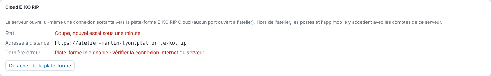

Un site hors ligne veut dire que le serveur RIP de l'atelier n'est pas relié à la plate-forme.
Les vérifications se font sur place.

## Avant de commencer

- Un e-mail « hors ligne » part quand le serveur est injoignable depuis 15 minutes.
- Il faut un accès physique ou réseau au serveur de l'atelier.

## Étapes

1. Vérifiez sur place que le serveur est allumé.
2. Vérifiez qu'il a accès à Internet.
3. Ouvrez **Système › Cloud E-KO RIP**.
4. Si le message **Plate-forme injoignable** s'affiche, corrigez la connexion Internet.

   
5. Attendez une minute : le serveur se reconnecte tout seul.

## Bon à savoir

- Si l'alerte est activée, un e-mail « de retour en ligne » confirme la reprise.
- Le travail à l'atelier n'est pas touché par une coupure du cloud.
- Si le site reste hors ligne, joignez le support en direct.
- Dans **Système › Cloud E-KO RIP**, un état **Coupé, nouvel essai sous une minute** signale que le serveur réessaie seul : il attend d'abord 1 seconde, puis 2, et ainsi de suite jusqu'à 60 secondes.
- Vous recevez l'e-mail « hors ligne » au plus une fois par site et par heure. Voir [Consulter la liste des e-mails de la plate-forme](../rip-cloud-compte/rip-cloud-comprendre-les-emails.md).
- Si un site apparaît hors ligne dans l'application mobile, voir [Un site apparaît hors ligne dans l'application mobile](../rip-depannage/rip-site-hors-ligne-dans-l-application-mobile.md).

## Voir aussi

- [Choisir les e-mails reçus](../rip-cloud-compte/rip-cloud-choisir-les-emails.md)
- [Joindre le support en direct](rip-cloud-joindre-le-support.md)
- [Relier un serveur RIP au cloud](../rip-cloud-premiers-pas/rip-cloud-relier-un-serveur.md)
