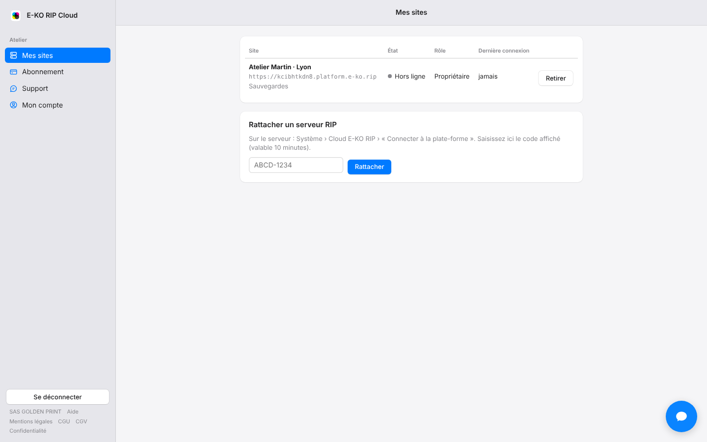

Le cloud E-KO RIP donne accès au serveur RIP de l'atelier depuis l'extérieur : à la maison, chez un client, en déplacement.
Cet article explique le principe avant de relier votre premier serveur.

## Avant de commencer

- Le cloud est **facultatif**. Le serveur continue de fonctionner normalement à l'atelier, avec ou sans lui.
- Il fonctionne **sans VPN** et sans rien changer à la box Internet.
- Il est **gratuit pour un petit atelier** (1 site, 1 imprimante et 1 découpeur, sans limite de durée). Des offres payantes couvrent les ateliers plus grands.

## Étapes

Voici ce que le cloud permet, et ce qu'il faut faire pour chaque usage.

1. **Atteindre le serveur depuis un poste hors de l'atelier.** Les postes Mac, Linux et Windows se connectent au serveur depuis n'importe où. Voir [Accéder à son serveur RIP à distance](rip-cloud-acceder-a-distance.md).
2. **Ouvrir l'interface d'administration dans un navigateur**, comme à l'atelier. Même article.
3. **Suivre la production avec l'application mobile**, hors de l'atelier. Voir [Connecter une app au cloud](rip-cloud-connecter-une-app.md).
4. **Être prévenu quand le serveur ne répond plus**, par notifications et par e-mails. Voir [Comprendre les notifications du cloud](../rip-cloud-compte/rip-cloud-comprendre-les-notifications.md).
5. **Conserver en ligne une sauvegarde de la configuration** du serveur. Voir [Comprendre les sauvegardes en ligne](../rip-cloud-sauvegardes/rip-cloud-comprendre-les-sauvegardes.md).

Le principe est simple : c'est le **serveur de l'atelier qui ouvre lui-même une connexion** vers la plate-forme (connexion sortante, comme une page web). **Aucun port n'est à ouvrir** sur la box. Les postes et les téléphones à distance passent par la plate-forme pour atteindre le serveur.

Pour démarrer, suivez dans l'ordre : [Créer un compte](rip-cloud-creer-un-compte.md), [Confirmer son adresse e-mail](rip-cloud-confirmer-adresse-email.md), puis [Relier un serveur RIP au cloud](rip-cloud-relier-un-serveur.md).

## Bon à savoir

- Sans le cloud, le serveur n'est joignable que sur le réseau de l'atelier.
- À distance, on se connecte soit avec **son compte de la plate-forme** (les apps, via **Se connecter au cloud**), soit avec **un compte du serveur RIP** (navigateur, adresse saisie à la main).
- Certaines fonctions restent réservées à l'atelier. Voir [Savoir ce qui ne passe jamais par le cloud](rip-cloud-ce-qui-reste-reserve-a-l-atelier.md).
- Les offres, leurs limites et les prix sont décrits dans [Choisir l'offre qui convient à son atelier](../rip-cloud-abonnement/rip-cloud-choisir-une-offre.md).

## Voir aussi

- [Découvrir le portail E-KO RIP Cloud](rip-cloud-decouvrir-le-portail.md)
- [Comprendre la sécurité du cloud](rip-cloud-securite.md)
- [Créer un compte sur la plate-forme](rip-cloud-creer-un-compte.md)
