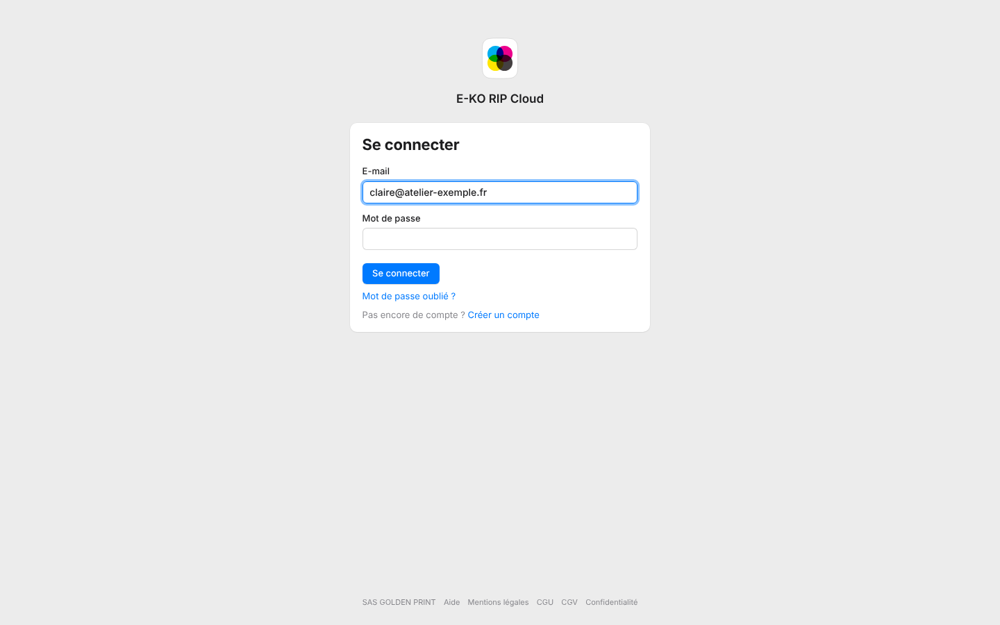
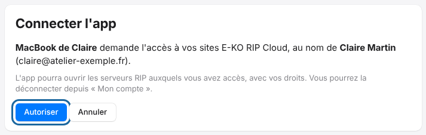

Les apps Mac, Linux et mobile se connectent au cloud en quelques clics.
Vous évitez de saisir une adresse et un second mot de passe.

## Avant de commencer

- Avoir un compte de la plate-forme et un serveur relié.
- L'accès d'une app reste valable environ 180 jours.

## Étapes

1. Sur l'écran de connexion de l'app, cliquez sur **Se connecter au cloud**. Le navigateur s'ouvre sur la plate-forme.
2. Connectez-vous avec votre compte (mot de passe, Google ou Facebook).
3. Autorisez l'application quand le portail le demande.
4. Revenez à l'application : elle affiche la liste des sites du compte, en ligne ou non.
5. Choisissez le site voulu.

À l'étape 3, le portail affiche **Connecter l'app** : cliquez sur **Autoriser** (ou **Annuler** pour refuser).

## Bon à savoir

- Les droits suivent le rôle du compte sur le site : un propriétaire ou un administrateur est administrateur du RIP, un opérateur est opérateur, un compte en lecture ne peut rien modifier.
- À chaque nouvelle app connectée, un e-mail de sécurité est envoyé au titulaire du compte.
- **Se déconnecter du cloud**, dans l'app, retire l'accès de l'appareil.
- Le portail ne montre que les sites pour lesquels votre compte a un rôle. Les droits dans l'app suivent ce rôle, donné dans le portail.
- Les apps demandent l'autorisation d'afficher des notifications juste après la première connexion. Voir [Activer les notifications du cloud](../rip-cloud-compte/rip-cloud-activer-les-notifications.md).
- Cette connexion remplace la saisie d'une adresse : voir aussi [Se connecter au cloud depuis le client Mac ou Linux](../rip-premiers-pas/rip-se-connecter-au-cloud-depuis-le-client.md).
- Les rôles sont expliqués dans [Comprendre les rôles sur un site](../rip-cloud-compte/rip-cloud-roles-sur-un-site.md).

## Voir aussi

- [Déconnecter les apps du cloud](../rip-cloud-compte/rip-cloud-deconnecter-les-apps.md)
- [Accéder à son serveur à distance](rip-cloud-acceder-a-distance.md)
