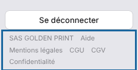

Les textes légaux de la plate-forme sont accessibles à tout moment, connecté ou non.

## Avant de commencer

- Aucun compte n'est nécessaire pour les lire.
- Les offres payantes s'adressent aux professionnels : les CGV s'appliquent à la souscription.

## Étapes

1. Ouvrez le portail, ou restez sur n'importe quelle page de la plate-forme.
2. En bas du menu à gauche, repérez les liens **Mentions légales**, **CGU**, **CGV** et **Confidentialité**.

   
3. Cliquez sur le texte voulu.

Les adresses directes sont :

| Texte | Adresse |
|---|---|
| Conditions générales d'utilisation | <https://platform.e-ko.rip/cgu> |
| Conditions générales de vente (offres payantes) | <https://platform.e-ko.rip/cgv> |
| Politique de confidentialité | <https://platform.e-ko.rip/confidentialite> |
| Mentions légales | <https://platform.e-ko.rip/mentions-legales> |

## Bon à savoir

- À l'inscription, vous acceptez les CGU et la politique de confidentialité en cochant la case du formulaire.
- Les CGV sont à accepter à la souscription d'une offre payante.
- Une question ? Écrivez à contact@e-ko.rip.
- Le lien **Aide**, à côté de ces liens, ouvre ce centre d'aide.

## Voir aussi

- [Créer un compte sur la plate-forme](rip-cloud-creer-un-compte.md)
- [Souscrire une offre payante](../rip-cloud-abonnement/rip-cloud-souscrire-une-offre.md)
- [Joindre le support en direct](../rip-cloud-depannage/rip-cloud-joindre-le-support.md)
