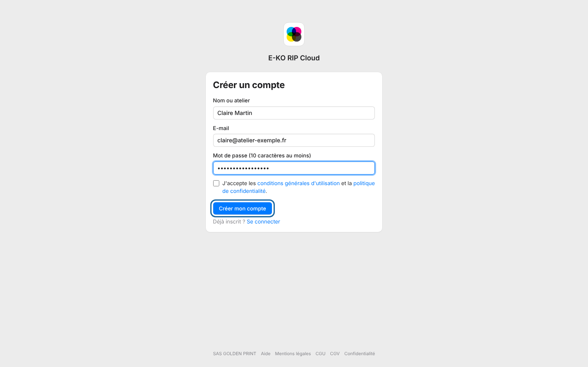

Le compte de la plate-forme donne accès au portail E-KO RIP Cloud.
Il s'adresse à toute personne qui veut relier le serveur de son atelier.

## Avant de commencer

- Ayez une adresse e-mail que vous consultez.
- Prévoyez un mot de passe d'au moins 10 caractères.
- Comptez deux minutes.

## Étapes

1. Ouvrez <https://platform.e-ko.rip>.
2. Cliquez sur **Créer un compte**.
3. Remplissez **Nom ou atelier**, **E-mail** et **Mot de passe (10 caractères au moins)**.
4. Cochez **J'accepte les conditions générales d'utilisation et la politique de confidentialité**.
5. Cliquez sur **Créer mon compte**.

   
6. Ouvrez l'e-mail de confirmation reçu et cliquez sur le lien qu'il contient.

## Bon à savoir

- Si la page propose **Google** ou **Facebook**, ces boutons permettent de s'inscrire sans mot de passe.
- Un compte créé avec Google est confirmé d'office. Sinon, un e-mail de confirmation vous est envoyé.
- Le cloud est facultatif : le serveur fonctionne à l'atelier avec ou sans lui.

## Voir aussi

- [Confirmer l'adresse e-mail](rip-cloud-confirmer-adresse-email.md)
- [Relier un serveur RIP au cloud](rip-cloud-relier-un-serveur.md)
- [Choisir une offre](../rip-cloud-abonnement/rip-cloud-choisir-une-offre.md)
- [Documentation du cloud](https://e-ko.rip/documentation/cloud/)
