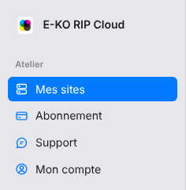

Le portail est le site web de la plate-forme : vous y gérez vos sites, votre abonnement et votre compte.
Cet article présente chaque page pour vous y retrouver.

## Avant de commencer

- Ayez un compte. Voir [Créer un compte sur la plate-forme](rip-cloud-creer-un-compte.md).
- Le portail se trouve à l'adresse <https://platform.e-ko.rip>.

## Étapes

1. Ouvrez <https://platform.e-ko.rip> et connectez-vous.
2. Repérez le menu à gauche : il regroupe les pages du portail.

   
3. Ouvrez **Mes sites** pour voir vos serveurs reliés : nom, adresse à distance, état (en ligne ou hors ligne), votre rôle et la dernière connexion. Vous y rattachez un serveur, vous le retirez (le propriétaire seulement) et vous ouvrez ses **Sauvegardes**.
4. Ouvrez **Abonnement** pour voir l'offre en cours, les machines comptées, le moyen de paiement et les factures (PDF), et pour changer d'offre ou résilier.
5. Ouvrez **Support** pour ouvrir la bulle du support en direct. Voir [Joindre le support en direct](../rip-cloud-depannage/rip-cloud-joindre-le-support.md).
6. Ouvrez **Mon compte** pour gérer vos connexions, vos e-mails, vos notifications, vos apps connectées et la suppression du compte. Voir [Consulter et gérer son compte](../rip-cloud-compte/rip-cloud-gerer-son-compte.md).
7. En bas du menu, **Se déconnecter** ferme votre session. Les liens **Mentions légales**, **CGU**, **CGV** et **Confidentialité** s'y trouvent aussi. Voir [Consulter les conditions et les mentions légales](rip-cloud-consulter-les-informations-legales.md).

## Bon à savoir

- Avant la connexion, le portail propose la création de compte, la connexion et **Mot de passe oublié ?**.
- Si l'adresse e-mail n'est pas confirmée, un bandeau l'indique sur **Mes sites** et **Mon compte**. Voir [Confirmer son adresse e-mail](rip-cloud-confirmer-adresse-email.md).
- La bulle du support en direct n'apparaît qu'une fois connecté.
- Le portail n'existe que sur l'adresse de la plate-forme, jamais sur l'adresse d'un site.
- Une rubrique **Plate-forme** (**Administration**) n'apparaît que pour l'équipe qui exploite la plate-forme.

## Voir aussi

- [Comprendre le cloud E-KO RIP](rip-cloud-comprendre-le-cloud.md)
- [Relier un serveur RIP au cloud](rip-cloud-relier-un-serveur.md)
- [Choisir une offre](../rip-cloud-abonnement/rip-cloud-choisir-une-offre.md)
