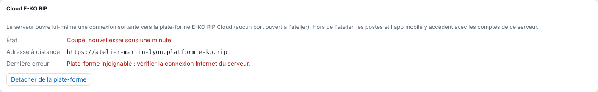

La section **Cloud E-KO RIP** du serveur indique si l'accès à distance fonctionne.
Elle donne l'adresse à distance et la dernière erreur éventuelle.

## Avant de commencer

- Ouvrez l'interface d'administration du serveur avec un compte administrateur.
- Depuis le client, ouvrez **Administration…**, puis la vue **Système**.

## Étapes

1. Ouvrez **Système**, puis la section **Cloud E-KO RIP**.
2. Lisez la ligne **État** :

   | État affiché | Signification |
   |---|---|
   | **Non rattaché** | Le serveur n'est pas relié à la plate-forme. |
   | **Connexion en cours…** | Le serveur ouvre sa connexion vers la plate-forme. |
   | **Connecté : accessible à distance** | Tout fonctionne : l'**Adresse à distance** est affichée. |
   | **Coupé, nouvel essai sous une minute** | La connexion est tombée ; le serveur réessaie seul. |

   
3. Si une **Dernière erreur** est affichée, lisez-la. Par exemple **Plate-forme injoignable : vérifier la connexion Internet du serveur.** signale un problème de connexion Internet.

   
4. Attendez une minute : après une coupure, le serveur se reconnecte seul (il attend d'abord 1 seconde, puis 2, et ainsi de suite jusqu'à 60 secondes).

## Bon à savoir

- Les boutons changent selon l'état : **Connecter à la plate-forme** quand le serveur n'est pas relié, **Abandonner** pendant l'attente d'un code, **Détacher de la plate-forme** quand il est relié.
- Si le texte « Le cloud demande au moins un compte sur ce serveur » apparaît, voir [Résoudre « le cloud demande au moins un compte »](../rip-cloud-depannage/rip-cloud-cloud-demande-un-compte.md).
- Un serveur qui n'a jamais été relié affiche **Non rattaché**.

## Voir aussi

- [Relier un serveur RIP au cloud](rip-cloud-relier-un-serveur.md)
- [Résoudre un site hors ligne](../rip-cloud-depannage/rip-cloud-site-hors-ligne.md)
- [Comprendre les messages d'erreur du cloud](../rip-cloud-depannage/rip-cloud-comprendre-les-messages-d-erreur.md)
