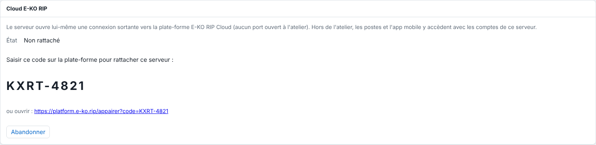
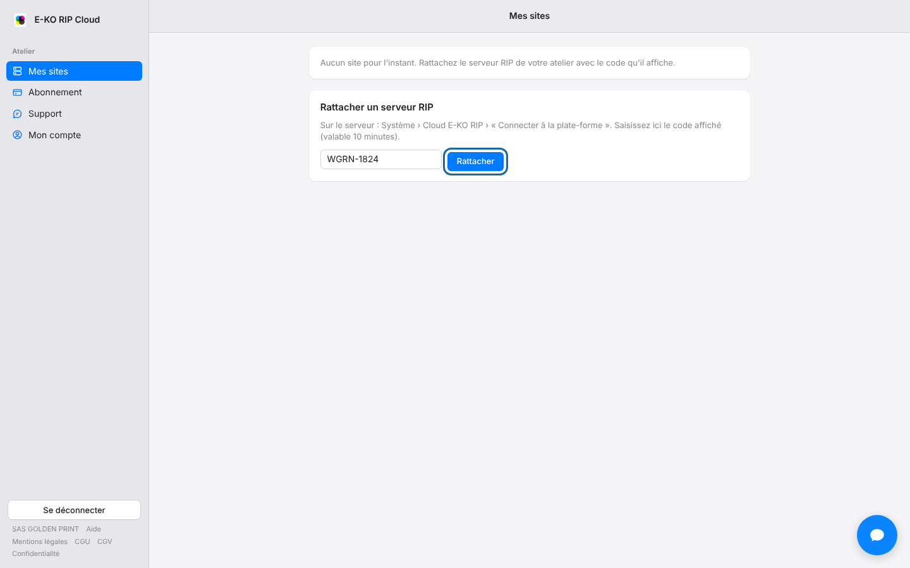

Relier le serveur permet de l'atteindre depuis l'extérieur de l'atelier.
Il faut un code sur le serveur, puis sa saisie sur le portail.

## Avant de commencer

- Le serveur doit avoir **au moins un compte utilisateur**. Sans compte, l'accès au serveur est libre sur le réseau local, et le cloud refuse de s'ouvrir pour ne pas laisser l'atelier ouvert à tous. Voir [Créer les comptes du serveur](../rip-administration/rip-creer-les-comptes.md).
- Le serveur doit avoir accès à Internet.
- Votre adresse e-mail de plate-forme doit être confirmée.
- Comptez deux minutes. Vous pouvez relier jusqu'à 10 sites par compte (dans la limite de l'offre).

## Étapes

1. Ouvrez l'interface d'administration du serveur RIP, avec un compte administrateur.
2. Allez dans **Système › Cloud E-KO RIP**.
3. Cliquez sur **Connecter à la plate-forme**. Le serveur affiche un code court, de la forme `KXRT-4821`, valable **10 minutes**.

   
4. Sur le portail, connectez-vous avec votre compte.
5. Allez dans **Mes sites**, rubrique **Rattacher un serveur RIP**.
6. Saisissez le code, puis cliquez sur **Rattacher**.

   

Quelques secondes plus tard, **Système › Cloud E-KO RIP** indique **Connecté : accessible à distance** et affiche l'**Adresse à distance**.

Le site apparaît dans **Mes sites**, avec son adresse à distance, son état et votre rôle.

## Bon à savoir

- Le serveur affiche aussi, sous le code, un lien : l'ouvrir mène directement à la page de saisie du code.
- Le compte qui saisit le code devient propriétaire du site.
- Le nom du site proposé est celui de la machine. Pour en proposer un autre, l'administrateur du serveur renseigne `EKO_RIP_CLOUD_NOM` dans `/etc/default/eko-rip-serveur`. La variable `EKO_RIP_CLOUD_URL` du même fichier désigne une autre plate-forme (essais) ; elle reste vide en usage normal.
- Si vous changez d'avis avant la saisie du code, cliquez sur **Abandonner** sur le serveur.
- Après une coupure de réseau, le serveur se reconnecte tout seul.
- Le rattachement se fait uniquement depuis l'atelier, jamais par le cloud.
- Si le code est refusé ou expiré, voir [Résoudre un code de rattachement expiré ou refusé](../rip-cloud-depannage/rip-cloud-code-expire.md).
- Si l'écran affiche « Le cloud demande au moins un compte sur ce serveur », voir [Résoudre « le cloud demande au moins un compte »](../rip-cloud-depannage/rip-cloud-cloud-demande-un-compte.md).

## Voir aussi

- [Installer le serveur RIP](../rip-premiers-pas/rip-installer-le-serveur.md)
- [Lire l'état du cloud sur le serveur](rip-cloud-lire-l-etat-du-cloud-sur-le-serveur.md)
- [Accéder à son serveur à distance](rip-cloud-acceder-a-distance.md)
- [Le code a expiré ou est refusé](../rip-cloud-depannage/rip-cloud-code-expire.md)
