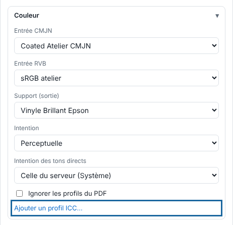

Le bloc **Couleur** décide comment les couleurs du fichier deviennent des encres. Cet article s'adresse à la personne qui règle le rendu.

## Avant de commencer

Vous avez le profil `.icc` ou `.icm` du support, fourni par son fabricant ou produit à l'atelier. Ajouter un profil demande un compte administrateur.

## Étapes

1. Dans **Administration…**, vue **Production**, cliquez **Importer**, puis ouvrez le bloc **Couleur**.
2. Cliquez **Ajouter un profil ICC…** et choisissez le fichier. Il est déposé sur le serveur.

   
3. Choisissez l'**Entrée CMJN** et l'**Entrée RVB** : le profil appliqué aux données qui n'en ont pas.
4. Choisissez le profil **Support (sortie)** : l'aperçu simule le rendu du support imprimé.
5. Choisissez l'**Intention** : perceptuelle, colorimétrique relative, saturation ou absolue.
6. Cochez **Ignorer les profils du PDF** pour appliquer ces profils à toutes les données.
7. Si vous voulez réutiliser ces choix, cliquez **Enregistrer…**, à côté de **Réglage**, pour les garder dans un réglage.

## Bon à savoir

- Les tons directs qui ont leur encre (`White`, `Silver`…) ne sont jamais convertis.
- Pour retoucher les couleurs d'un seul travail, utilisez le **Filtre couleur** de la visionneuse (bouton **Couleur**) : courbes, luminosité, saturation et remplacement de couleur.
- Un changement vaut pour les rendus suivants : relancez un travail déjà rendu.

## Voir aussi

- [Déclarer les tons directs de l'atelier](rip-declarer-les-tons-directs.md)
- [Régler un support et ses modes d'impression](rip-regler-un-support-et-ses-modes.md)
- [Faire une épreuve TIFF](rip-faire-une-epreuve-tiff.md)
- Page détaillée : https://e-ko.rip/documentation/utilisation/
