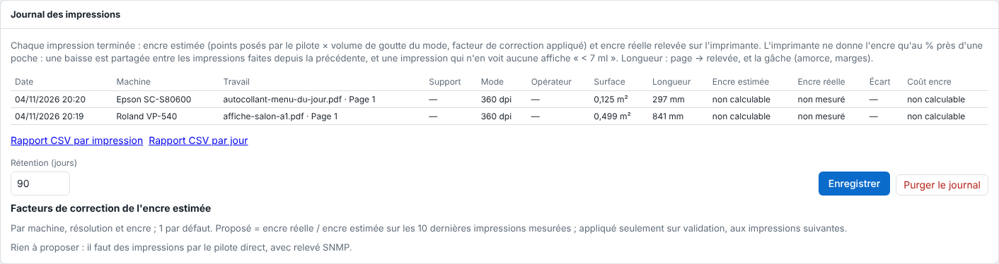

Le journal garde chaque impression terminée avec ce qu'elle a consommé. Cet article s'adresse à l'administrateur et aux responsables de production.

## Avant de commencer

Pour mesurer l'encre réelle, l'Epson doit être pilotée en connexion **Réseau (TCP)** avec une adresse **SNMP**. Sans SNMP, l'encre réelle est **non mesuré**.

## Étapes

1. Ouvrez **Administration…**, vue **Système**, section **Journal des impressions** : les 200 dernières impressions, la plus récente en haut.

   
2. Lisez les colonnes : **Date**, **Machine**, **Travail** (et sa page), **Support**, **Mode**, **Opérateur** (celui de la fiche travail), **Surface**, **Longueur**, **Encre estimée**, **Encre réelle**, **Écart** et **Coût encre**. Le survol de l'encre estimée ou réelle donne le détail par encre (BK, C, LC…).
3. Pour régler la conservation, saisissez la **Rétention (jours)** (90 par défaut), puis **Enregistrer**.
4. Pour vider le journal, cliquez **Purger le journal** et indiquez combien de derniers jours garder (0 : tout effacer).

## Bon à savoir

- **Encre réelle** : par le pilote direct, le serveur relève l'Epson (SNMP) juste avant l'envoi et juste après la fin de l'impression, en plus du relevé de chaque minute. Ce qui a baissé entre les deux est rangé dans la sortie ; la file l'affiche sur la ligne de la sortie terminée : `Relevé : encre 14 ml, support 574 mm`.
- L'imprimante ne donne l'encre qu'au % près d'une poche (1 % de 700 ml = 7 ml) : une impression qui ne voit aucune baisse affiche **< 7 ml**, jamais 0. Une baisse de 1 % s'est faite depuis la variation précédente du même canal : elle est partagée entre toutes les impressions faites depuis, au prorata de leur encre estimée (à défaut, de leur durée). Un chiffre isolé reste approximatif ; la somme sur une période est fiable.
- Une baisse hors de toute impression (nettoyage) n'est attribuée à personne ; un changement de poche n'est pas une consommation.
- La contenance d'une poche est celle de la cartouche saisie dans **Coûts d'encre et de support** (ligne de l'encre, de sa plaque ou **Toutes les autres**), 700 ml sinon.
- **Longueur** : `369 → 574 mm (gâche 204 mm)` : la longueur de la page, celle relevée sur le rouleau entre le début et la fin, et la différence (amorce, tête vide, marges). À vérifier à l'atelier sur un vrai tirage (travail de 369,8 mm, 574 mm relevés, soit 204 mm de gâche).
- **Encre estimée** : par le pilote direct, les points posés par le tramage sont comptés encre par encre et taille par taille ; *ml = Σ points × volume de goutte du mode*, multiplié par le facteur de correction validé. Une sortie en dossier (plaques en ton continu, tramées par un autre logiciel) est **non calculable** : ni encre ni coût encre, plutôt qu'un chiffre faux. L'estimation affichée sur la carte du travail avant impression reste celle de la couverture de l'aperçu.
- La purge passe toutes les 5 minutes. Les travaux et la file ne sont jamais touchés ; les relevés de l'imprimante restent.
- La rétention est dans la sauvegarde de la configuration.

## Voir aussi

- [Exporter les rapports CSV de consommation](rip-exporter-les-rapports-csv-de-consommation.md)
- [Corriger l'estimation d'encre avec les facteurs de correction](rip-corriger-l-estimation-d-encre.md)
- [Régler les coûts d'encre et de support](rip-regler-les-couts-d-encre-et-de-support.md)
