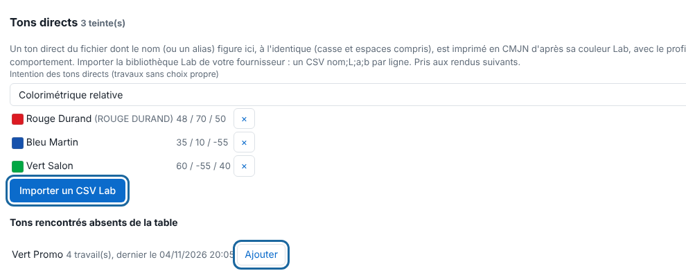
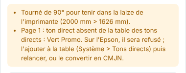

Un ton direct du fichier (une teinte nommée) n'a pas d'encre propre : le RIP l'imprime en CMJN. La table des tons directs lui donne la bonne couleur.

## Avant de commencer

Il vous faut un compte administrateur. Pour importer une bibliothèque, vous avez un CSV de valeurs Lab dont vous avez le droit de vous servir : aucune bibliothèque n'est livrée avec le RIP.

## Étapes

1. Ouvrez **Administration…**, puis la vue **Système**, section **Tons directs**.

   
2. Pour savoir quels tons déclarer, envoyez un fichier qui les utilise : un ton absent de la table est signalé dans l'inspecteur du travail.

   
3. Dans **Tons rencontrés absents de la table**, cliquez **Ajouter** à côté du ton, puis saisissez sa couleur Lab sous la forme `L a b` (par exemple `48 68 48`).
4. Pour importer en une fois, cliquez **Importer un CSV Lab**. Chaque ligne s'écrit `nom;L;a;b`.
5. Réglez l'**Intention des tons directs** (colorimétrique relative par défaut).
6. Pour retirer un ton, cliquez **×** sur sa ligne et confirmez.
7. Relancez les travaux déjà rendus : la table n'est prise en compte qu'aux rendus suivants.

## Bon à savoir

- Le nom doit être identique : la casse et les espaces comptent (« PANTONE 485 C » ne trouve pas « Pantone 485 C »).
- Si un nom du CSV existe déjà, tout l'import est refusé, sans rien écrire.
- `White`, `Silver`, `Metallic` et les tons de découpe ne peuvent pas entrer dans la table.
- Un ton du fichier absent de la table est signalé sur la page (« ton direct absent de la table des tons directs ») et listé dans **Tons rencontrés absents de la table** : **Ajouter** le fait entrer avec sa valeur Lab.
- Un ton écrit de plusieurs façons dans vos fichiers s'ajoute une fois par écriture.
- Une teinte à 50 % pose la moitié de la recette CMJN de la teinte pleine.

## Voir aussi

- [Choisir les profils de couleur d'un travail](rip-choisir-les-profils-de-couleur.md)
- [Poser du blanc automatiquement](rip-poser-du-blanc-automatique.md)
- [Envoyer un travail au RIP](../rip-travaux/rip-envoyer-un-travail.md)
- Page détaillée : https://e-ko.rip/documentation/utilisation/
