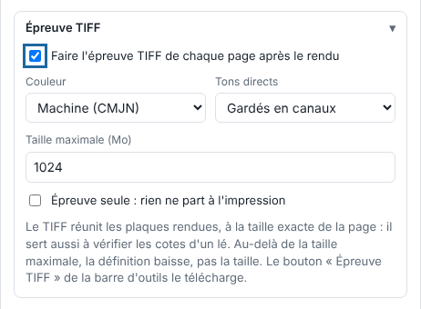
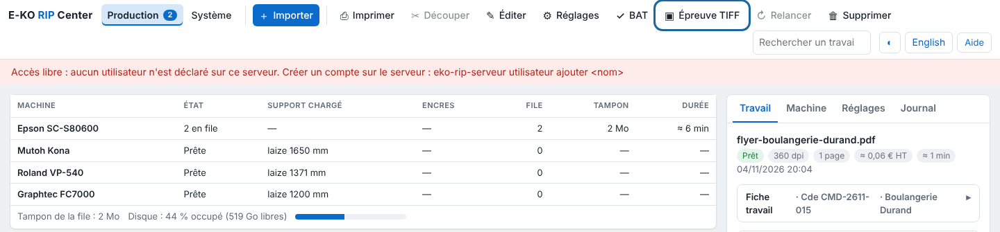

L'épreuve TIFF est faite à partir des plaques rendues, donc de ce qui part à la machine, à la taille exacte de la page. Elle sert aussi à vérifier les cotes d'un lé.

## Avant de commencer

Le rendu du travail est fini. Aucun droit particulier n'est requis.

## Étapes

1. Dans **Administration…**, vue **Production**, cliquez **Importer**, puis ouvrez le bloc **Épreuve TIFF**.
2. Cochez **Faire l'épreuve TIFF de chaque page après le rendu** pour l'avoir dès la fin du rendu.

   
3. Choisissez la **Couleur** : **Machine (CMJN)** pour les valeurs d'encre telles qu'envoyées, ou **Colorimétrique (RVB)** pour voir le rendu à l'écran.
4. Choisissez le sort des **Tons directs** : **Gardés en canaux**, **Aplatis dans la couleur** ou **Supprimés**.
5. Réglez la **Taille maximale (Mo)** (1 à 3500 Mo, non compressée).
6. Pour un travail déjà reçu, cliquez-le dans le tableau, puis cliquez **Épreuve TIFF** dans la barre d'outils : l'épreuve se fait à la demande et se télécharge.

   

## Bon à savoir

- Au-delà de la taille maximale, la définition baisse mais la taille physique reste exacte.
- **Épreuve seule** : l'épreuve est faite après le rendu et rien ne part à l'impression, mais le travail peut encore être découpé.
- Les tons de découpe ne sont jamais dans l'épreuve.
- Une épreuve qui échoue n'arrête pas le travail : elle est signalée dans ses alertes.
- Ces réglages se gardent dans un réglage enregistré.

## Voir aussi

- [Valider un BAT avec le client](../rip-travaux/rip-valider-un-bat.md)
- [Choisir les profils de couleur d'un travail](rip-choisir-les-profils-de-couleur.md)
- [Envoyer un travail au RIP](../rip-travaux/rip-envoyer-un-travail.md)
- Page détaillée : https://e-ko.rip/documentation/utilisation/
