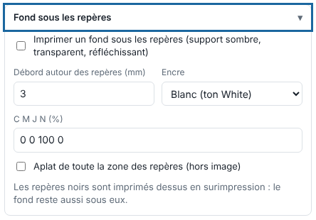

Sur un support sombre, transparent ou réfléchissant, le Kona lit mal les repères noirs. Un fond d'encre sous eux règle le problème. Cet article s'adresse aux opérateurs.

## Avant de commencer

Le travail est en mode **Imprimer** avec un **Repérage Kona** (voir [Choisir le repérage Kona](../rip-machines/rip-choisir-le-reperage-kona.md)).

## Étapes

1. Cliquez **Importer** et ouvrez le bloc **Fond sous les repères**.
2. Cochez **Imprimer un fond sous les repères (support sombre, transparent, réfléchissant)** : une bande d'encre déborde de chaque repère et code-barres.
3. Réglez le **Débord autour des repères (mm)**, de 0,5 à 13 mm.
4. Choisissez l'**Encre** : blanc (ton `White`) ou CMJN, dont vous saisissez les valeurs en %.
5. Pour toute la zone des repères, cochez **Aplat de toute la zone des repères (hors image)**.

   
6. Cliquez **Envoyer au RIP**.

## Bon à savoir

- Les repères noirs sont imprimés dessus en surimpression : le fond reste aussi sous eux.
- Une planche n'imbrique que des travaux au même fond sous les repères.
- Avec du blanc, l'imprimante doit avoir une encre blanche.

## Voir aussi

- [Choisir le repérage Kona](../rip-machines/rip-choisir-le-reperage-kona.md)
- [Poser du blanc automatiquement](rip-poser-du-blanc-automatique.md)
- [Brancher la Mutoh Kona 1650](../rip-machines/rip-brancher-mutoh-kona-1650.md)
