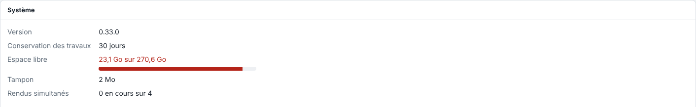

La vue **Système** réunit l'état du serveur et la plupart de ses réglages. Cet article en donne le plan, pour les administrateurs.

## Avant de commencer

Un compte **Opérateur** voit l'état ; les blocs réservés à l'administrateur demandent un compte administrateur.

## Étapes

1. Ouvrez la vue **Système** à côté de **Production**.

   
2. Lisez le premier bloc : la version du serveur, la durée de conservation des travaux (30 jours par défaut, réglée par `EKO_RIP_CONSERVATION_JOURS`), l'espace libre du disque des données (en rouge sous 10 %), le tampon et les rendus simultanés.
3. Lisez « Fichiers et dossiers » : un dossier ou un fichier d'état manquant ou abîmé y est signalé.
4. Descendez dans les blocs : **Découpe**, **Tons directs**, **Pont ERP**, **Cloud E-KO RIP**, **Statistiques anonymes**, **Rapports de bug**, **Machines**, **Média chargé dans l'Epson**, **Journal des impressions**, **Supports de l'Epson**, **Règles du dossier automatique**, **Coûts d'encre et de support** et **Sauvegarde de la configuration**.

## Bon à savoir

- Le bloc **Découpe** (administrateur) porte les préfixes de découpe, les calques non imprimables, les tracés ouverts, le tri des tracés et le choix **Après coupe** (voir [Régler les préfixes de découpe](../rip-travaux/rip-regler-les-prefixes-de-decoupe.md)).
- Les blocs **Machines**, **Supports de l'Epson**, **Règles du dossier automatique**, **Coûts** et **Sauvegarde** ne s'affichent qu'à l'administrateur.
- Le disque des données se lit aussi dans la vue **Production** (voir [Lire l'écran Production](../rip-travaux/rip-lire-l-ecran-production.md)).
- Les travaux sont purgés après la durée de conservation ; sous 5 Go libres, le serveur efface lui-même les plus vieux travaux inactifs.

## Voir aussi

- [Lire l'écran Production](../rip-travaux/rip-lire-l-ecran-production.md)
- [Sauvegarder la configuration du serveur](../rip-administration/rip-sauvegarder-la-configuration.md)
- [Ajouter une machine au RIP](../rip-machines/rip-ajouter-une-machine.md)
