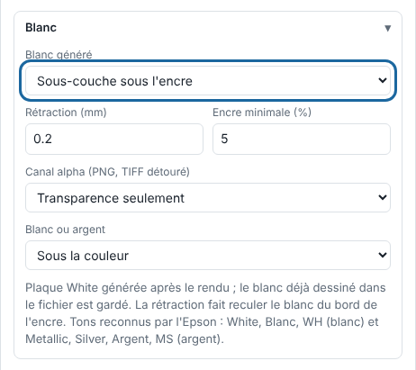

Le blanc évite que la couleur se perde sur un support transparent ou coloré. Le RIP peut le générer lui-même après le rendu.

## Avant de commencer

L'imprimante a une encre blanche. Le travail est en mode **Imprimer**. Sachez que le blanc et l'argent ne passent pas encore par le pilote direct de l'Epson : voir [Brancher l'Epson SC-S80600](../rip-machines/rip-brancher-epson-sc-s80600.md).

## Étapes

1. Dans **Administration…**, vue **Production**, cliquez **Importer**, puis ouvrez le bloc **Blanc**.
2. Dans **Blanc généré**, choisissez **Sous-couche sous l'encre** pour du blanc partout où une encre dépasse l'**Encre minimale (%)** (5 par défaut), ou **Aplat sur toute la page** pour du blanc sur toute la page.

   
3. Réglez la **Rétraction (mm)** (0,2 mm par défaut, jusqu'à 5 mm) : le blanc recule depuis le bord de l'encre pour ne pas dépasser de la couleur.
4. Dans **Blanc ou argent**, choisissez de poser le blanc **Sous la couleur** ou **Sur la couleur (vitrophanie)**.
5. Envoyez le travail, puis ouvrez **Couches** dans l'inspecteur pour voir la plaque `White`.
6. Pour garder ce choix, cliquez **Enregistrer…**, à côté de **Réglage**, pour l'ajouter à un réglage.

## Bon à savoir

- Le blanc déjà dessiné dans le fichier (ton direct `White`) est gardé : le blanc final réunit les deux.
- Les noms reconnus sont `White`, `Blanc` ou `WH` pour le blanc ; `Metallic`, `Silver`, `Argent` ou `MS` pour l'argent.
- La plaque générée apparaît dans les aperçus, compte dans le coût et part à l'Epson avec les autres plaques (en connexion Dossier pour l'instant). Un réglage enregistré garde le choix de blanc.
- Pour les noms reconnus et le détail des plaques, voir [Comprendre les plaques d'encre et les noms de tons directs](rip-comprendre-les-plaques-et-les-tons-directs.md).
- Sur une plaque, le noir est l'encre et le blanc l'absence d'encre.
- Pour un PNG ou un TIFF détouré, le réglage **Canal alpha** peut donner une plaque `White` ou `Varnish` qui suit le détourage : voir [Poser du blanc ou du vernis depuis un canal alpha](rip-poser-du-blanc-ou-du-vernis-depuis-un-canal-alpha.md).

## Voir aussi

- [Déclarer les tons directs de l'atelier](rip-declarer-les-tons-directs.md)
- [Brancher l'Epson SureColor SC-S80600](../rip-machines/rip-brancher-epson-sc-s80600.md)
- [La sortie vers la machine a échoué](../rip-depannage/rip-sortie-vers-la-machine-echouee.md)
