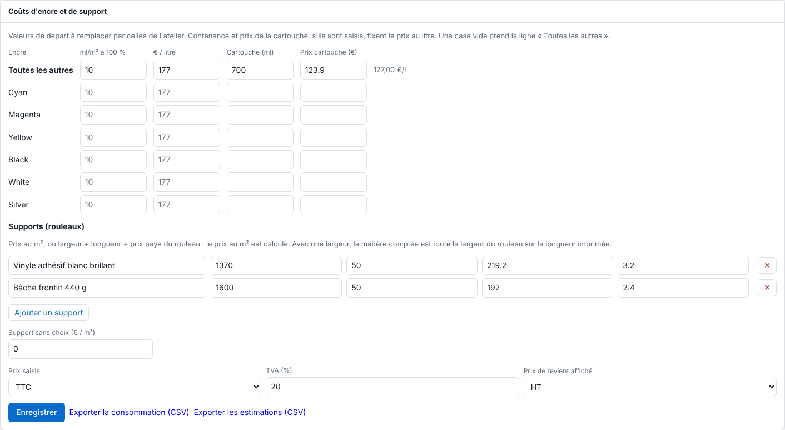

Chaque page affiche sa surface, l'encre estimée et son coût. Cet article explique comment régler les tarifs de l'atelier. Il s'adresse à l'administrateur.

## Avant de commencer

Il vous faut un compte administrateur et vos prix : factures de cartouches et de rouleaux, ou pesée d'un tirage connu.

## Étapes

1. Ouvrez **Administration…**, vue **Système**, section **Coûts d'encre et de support**.

   
2. Pour chaque encre, saisissez les **ml/m² à 100 %** et les **€ / litre**. La ligne **Toutes les autres** sert aux cases vides.
3. Ou saisissez la contenance (ml) et le prix d'une **cartouche** : le prix au litre en est tiré.
4. Dans **Supports (rouleaux)**, cliquez **Ajouter un support** : donnez son nom et soit son prix au m², soit sa largeur, sa longueur et le prix payé du rouleau (le prix au m² est calculé).
5. Réglez **Prix saisis** (**TTC** ou **HT**), le taux de **TVA** (20 % par défaut) et le **Prix de revient affiché** (HT par défaut).
6. Cliquez **Enregistrer**.
7. À l'envoi, choisissez le support dans **Support (prix de revient)** (gardé dans les réglages). La carte du travail affiche alors son **prix de revient** (encre + matière).

## Bon à savoir

- Le calcul : pour chaque plaque, *taux × surface × ml/m² à 100 %* donne les ml, puis *ml ÷ 1000 × prix au litre* le coût ; le support coûte *surface × prix au m²*. Les tons de découpe ne comptent pas. Sous chaque vignette de plaque s'affiche son taux d'encre (part de la page couverte à 100 %).
- Une page indique par exemple : `0,42 m² · encre 3,1 ml · ≈ 1,92 € (encre 0,44 €, support 1,48 €)`.
- Les valeurs livrées (10 ml/m², cartouche Epson de 700 ml à 123,90 € TTC soit 177 €/l, support HEXIS V3000WG à 1,97 €/m² en rouleau de 1600 mm × 45 m) sont des valeurs de départ : remplacez-les par celles de l'atelier.
- Un changement de tarif s'applique aussi aux travaux déjà faits.
- Avec une largeur connue, la matière comptée est toute la largeur du rouleau sur la longueur imprimée. Sans largeur connue, le support compté est la surface de la page, pas la longueur de rouleau consommée sur toute la laize.
- La carte, l'estimation de chaque page et le CSV (colonne `base`) suivent le choix HT ou TTC.
- Les rapports se téléchargent : voir [Exporter les rapports CSV de consommation](rip-exporter-les-rapports-csv-de-consommation.md).

## Voir aussi

- [Exporter les rapports CSV de consommation](rip-exporter-les-rapports-csv-de-consommation.md)
- [Consulter le journal des impressions](rip-consulter-le-journal-des-impressions.md)
- [Régler un support et ses modes d'impression](rip-regler-un-support-et-ses-modes.md)
