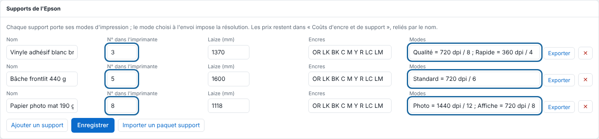

Le catalogue des supports relie ce que vous chargez dans l'Epson à la résolution du rendu et aux tarifs. Cet article s'adresse à l'administrateur.

## Avant de commencer

Il vous faut un compte administrateur. Enregistrez d'abord le support dans l'Epson sous un numéro, et notez ce numéro.

## Étapes

1. Ouvrez **Administration…**, puis la vue **Système**, section **Supports de l'Epson**.
2. Cliquez **Ajouter un support** et saisissez son **Nom**.
3. Saisissez le **N° dans l'imprimante**, c'est-à-dire le numéro enregistré dans l'Epson. Il permet de reconnaître le support chargé.
4. Saisissez la **Laize (mm)** et les **Encres**.
5. Écrivez ses **Modes** d'impression, séparés par des points-virgules : `Nom = 720 dpi / 8 passes ; Autre = 360 dpi / 4`.

   
6. Cliquez **Enregistrer**.
7. À l'envoi d'un travail (**Importer**), choisissez le support dans **Support et mode d'impression** : le mode impose la résolution du rendu.

## Bon à savoir

- **— résolution choisie à la main —** garde la résolution du panneau d'envoi.
- Changer de mode sur un travail reçu refait le rendu.
- Le support chargé est reconnu par son numéro lu sur l'imprimante, ou choisi à la main dans la liste (le choix prime jusqu'au retour à **— lu sur l'imprimante —**). Une impression attend que le support chargé soit celui du travail (**Autre support**), puis part seule.
- **Exporter** (sur la ligne d'un support) crée un paquet que **Importer un paquet support** reprend sur un autre serveur.
- Un troisième champ facultatif d'un mode donne le volume des gouttes petite, moyenne et grosse pour l'encre estimée : `Autre = 360 dpi / 4 / 5-10-15 pL`. Sans lui, 5-10-15 pL (valeurs de départ à étalonner). Chaque support et chaque mode garde un identifiant stable : le renommer ne le change pas.
- La séparation des encres claires et l'encre totale d'un mode se règlent aussi : voir [Régler les encres claires et l'encre totale d'un mode](rip-regler-les-encres-claires-et-l-encre-totale.md).
- Un support se transporte d'un serveur à l'autre : voir [Partager un support avec un paquet support](rip-partager-un-support-avec-un-paquet.md).
- Les prix du support et de l'encre se règlent dans **Système › Coûts d'encre et de support** : remplacez les valeurs de départ par celles de l'atelier.
- Écran **Système › Média chargé dans l'Epson** : la laize du rouleau chargé, lue par le réseau, se reprend avec **Utiliser comme laize**.

## Voir aussi

- [Brancher l'Epson SureColor SC-S80600](../rip-machines/rip-brancher-epson-sc-s80600.md)
- [Choisir les profils de couleur d'un travail](rip-choisir-les-profils-de-couleur.md)
- [Envoyer un travail au RIP](../rip-travaux/rip-envoyer-un-travail.md)
