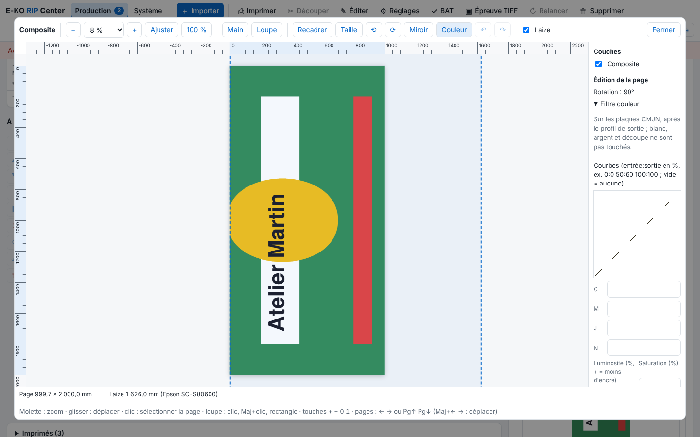

Le filtre couleur retouche un travail sans repasser par le logiciel de mise en page. Il est propre au travail. Cet article s'adresse aux opérateurs.

## Avant de commencer

Le travail est un PDF rendu, sans mosaïque. Le filtre agit sur les plaques CMJN, après le profil de sortie et avant le blanc automatique ; blanc, argent et découpe ne sont pas touchés.

## Étapes

1. Ouvrez le travail dans la visionneuse (voir [Utiliser la visionneuse pour contrôler un travail](../rip-travaux/rip-utiliser-la-visionneuse.md)), puis cliquez **Couleur** : le bloc **Filtre couleur** s'ouvre à droite.

   
2. Pour une courbe, saisissez dans C, M, J ou N des points « entrée:sortie » en % (par exemple `0:0 50:60 100:100`), 16 au plus ; vide = aucune.
3. Réglez la **Luminosité** (+ = moins d'encre) et la **Saturation**, de −100 à 100 %.
4. Pour changer une teinte, cliquez **Ajouter un remplacement** : choisissez une teinte CMJN **De** et une teinte CMJN **Vers**, avec une **Plage** (± %). 20 remplacements au plus ; la case **Actif** les allume, **Retirer** les supprime. Le remplacement passe avant le reste du filtre.
5. Pour comparer, utilisez **Avant / après (gauche : avant)** : un aperçu scindé sur un filtre déjà rendu ; le curseur déplace la séparation.
6. Cliquez **Appliquer** : le rendu est refait.
7. Pour réutiliser le filtre, cliquez **Exporter vers le réglage** et choisissez un réglage enregistré, ou **Nouveau réglage (réglages de ce travail)**. Le filtre est repris à l'import.
8. Pour l'enlever, cliquez **Sans filtre**.

## Bon à savoir

- L'« après » estime l'effet sur l'épreuve écran.
- Un filtre couleur est mentionné sur le BAT, mais l'épreuve ne le montre pas (voir [Valider un BAT avec le client](../rip-travaux/rip-valider-un-bat.md)).
- Pour des profils ICC, voir [Choisir les profils de couleur d'un travail](rip-choisir-les-profils-de-couleur.md).

## Voir aussi

- [Choisir les profils de couleur d'un travail](rip-choisir-les-profils-de-couleur.md)
- [Utiliser la visionneuse pour contrôler un travail](../rip-travaux/rip-utiliser-la-visionneuse.md)
- [Recadrer, redimensionner ou tourner une page](../rip-travaux/rip-recadrer-redimensionner-ou-tourner-une-page.md)
