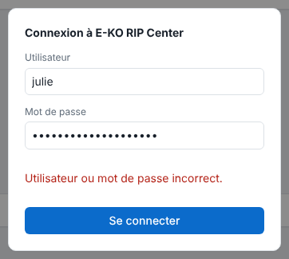
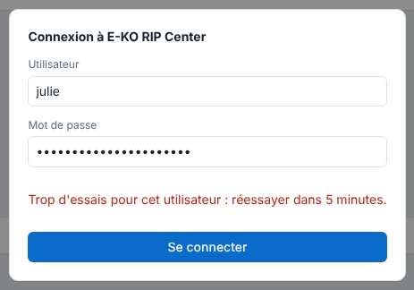
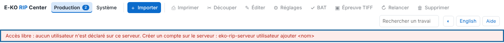

Trois messages reviennent souvent autour des comptes. Cet article donne la cause de chacun et la marche à suivre.

## Avant de commencer

Selon le message, vous avez besoin d'un terminal sur le serveur ou d'un compte administrateur.

## Étapes

1. Lisez le message exact affiché sous le mot de passe.
2. Pour **« Utilisateur ou mot de passe incorrect. »** : vérifiez le nom et le mot de passe (majuscules comprises), puis réessayez.

   
3. Pour **« Trop d'essais pour cet utilisateur : réessayer dans 5 minutes. »** : cinq mots de passe faux ont bloqué ce nom 5 minutes. Attendez, puis réessayez.

   
4. En cas de mot de passe oublié, un administrateur redéclare le compte avec `utilisateur ajouter` : le nouveau mot de passe remplace l'ancien.
5. Pour **« Réservé à l'administrateur du RIP. »** : votre compte est **opérateur**. Demandez à un administrateur de faire le réglage, ou de vous donner le rôle administrateur.
6. Pour **« Accès libre »** en rouge : aucun compte n'est déclaré. Créez un compte administrateur.

   

## Bon à savoir

- Machines, supports, tarifs, profils, réglages enregistrés et sauvegarde sont réservés à l'administrateur.
- Redémarrer le service débloque un nom aussitôt, mais ferme toutes les sessions.
- La session dure 12 heures : passé ce délai, le client demande de se reconnecter.

## Voir aussi

- [Créer les comptes du serveur](../rip-administration/rip-creer-les-comptes.md)
- [Gérer les comptes du serveur](../rip-administration/rip-gerer-les-comptes.md)
- [Le client ne trouve pas le serveur](rip-client-ne-trouve-pas-le-serveur.md)
- [Signaler un problème à l'équipe](rip-signaler-un-probleme.md)
