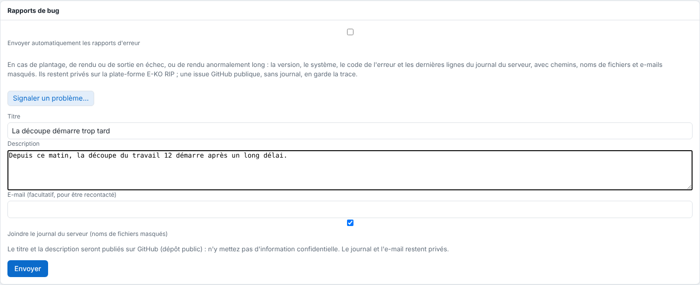

Quand vous êtes bloqué, le plus rapide est de signaler le problème depuis le logiciel : le rapport part avec les informations utiles à l'équipe. Cet article explique comment l'envoyer et ce qui est rendu public.

## Avant de commencer

Notez le message exact affiché et la version du serveur (vue **Système**, ligne **Version**). Ne mettez dans le titre et la description aucune information confidentielle.

## Étapes

1. Ouvrez le formulaire :
   - sur **Mac** : menu **Aide**, puis **Signaler un problème…** ;
   - sur **Linux** : menu principal, puis **Signaler un problème…** ;
   - dans l'**administration** (navigateur ou fenêtre Administration) : **Système › Rapports de bug › Signaler un problème…**.
2. Saisissez le **Titre** et la **Description** : ce que vous faisiez, ce que vous attendiez, ce qui s'est passé.
3. Renseignez l'**E-mail** (facultatif, pour être recontacté).
4. Laissez cochée la case **Joindre le journal du serveur** (noms de fichiers masqués).

   
5. Cliquez **Envoyer**. Le message « Merci, rapport envoyé (référence R-XXXXXXXX). » s'affiche : notez la référence.

## Bon à savoir

- **Le titre et la description sont publiés sur GitHub** (issue du dépôt public) : n'y mettez rien de confidentiel. Le journal et l'e-mail restent privés.
- Le poste envoie le rapport à son serveur RIP, qui joint son journal masqué (chemins, noms de fichiers et e-mails remplacés) et le transmet à la plate-forme E-KO RIP.
- Vous pouvez aussi écrire à [contact@e-ko.rip](mailto:contact@e-ko.rip) en indiquant la version du serveur et le message exact.
- Pour que le serveur envoie seul ses rapports d'erreur, voir [Autoriser ou refuser l'envoi automatique des rapports d'erreur](../rip-administration/rip-autoriser-les-rapports-d-erreur-automatiques.md).
- Les nouveautés de chaque version sont dans le [journal des versions](https://e-ko.rip/changelog/), avec un abonnement par e-mail.

## Voir aussi

- [Autoriser ou refuser l'envoi automatique des rapports d'erreur](../rip-administration/rip-autoriser-les-rapports-d-erreur-automatiques.md)
- [Surveiller le service du serveur](../rip-administration/rip-surveiller-le-service-du-serveur.md)
- [Résoudre un rendu en échec ou un fichier refusé](rip-un-rendu-echoue.md)
- [Joindre le support](../rip-cloud-depannage/rip-cloud-joindre-le-support.md)
