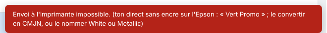
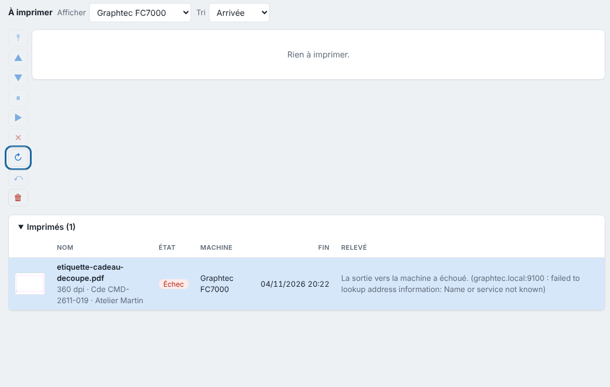

Une sortie peut échouer entre le serveur et la machine. Le message est affiché sous la sortie, dans la file.

## Avant de commencer

Vous voyez la sortie en échec dans la file de la machine. Accédez à la machine pour lever une alerte physique.

## Étapes

1. Ouvrez **Imprimés** (vue **Production**) et cliquez la sortie en échec : le message s'affiche dans la colonne **Relevé**.
2. Pour **« La sortie vers la machine a échoué. »** : vérifiez que la machine est allumée, joignable, que son port USB existe et que le droit d'écriture est accordé.
3. Pour **« L'imprimante signale une alerte : impression arrêtée. »** : levez l'alerte sur la machine (capot ouvert, cartouche vide…).
4. Pour **« Envoi à l'imprimante impossible. »** sur l'Epson, un message rouge s'affiche au moment de l'envoi : renommez le ton direct `White` ou `Metallic`, convertissez-le en CMJN, ou ajoutez-le à la table des tons directs (**Système › Tons directs**). Puis relancez le travail.

   
5. Une fois la cause réglée, cliquez la sortie dans **Imprimés**, puis **Refaire** (↻), dans la colonne de boutons à gauche de la liste.

   

## Bon à savoir

- Si une machine ne peut pas être retirée du catalogue, c'est qu'**une sortie attend encore cette machine dans la file** : passez-la ou annulez-la d'abord.
- En connexion réseau directe, le blanc et l'argent passent pour l'instant par une machine en connexion **Dossier**.
- Si la durée estimée ne correspond pas à la réalité, mesurez la cadence réelle (m² par heure sur la laize) et saisissez-la en **Cadence** de la machine.
- Pas de notification sur le téléphone : vérifiez l'autorisation dans les réglages du téléphone et l'interrupteur **Notifications** de l'application.

## Voir aussi

- [Gérer la file d'une machine](../rip-travaux/rip-gerer-la-file-d-une-machine.md)
- [Choisir la connexion d'une machine](../rip-machines/rip-choisir-la-connexion-d-une-machine.md)
- [Brancher l'Epson SureColor SC-S80600](../rip-machines/rip-brancher-epson-sc-s80600.md)
- Page détaillée : https://e-ko.rip/documentation/depannage/
