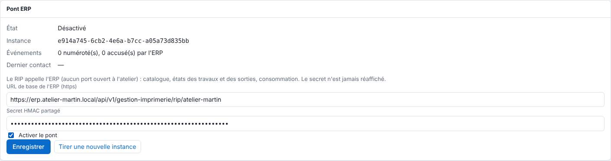

L'écran **Système › Pont ERP** relie le RIP à l'ERP : URL, secret et activation. Il montre aussi l'état du pont. Réservé à l'administrateur.

## Avant de commencer

Vous êtes connecté avec un compte administrateur. Vous avez créé le secret (voir [Créer le jeton et le secret du pont ERP](rip-creer-le-jeton-et-le-secret-du-pont-erp.md)) et vous disposez de l'URL donnée par l'écran du pont de l'ERP. Le serveur doit pouvoir joindre l'ERP en HTTPS sortant : aucun port à ouvrir.

## Étapes

1. Dans le client, ouvrez **Administration…**, puis la vue **Système**, section **Pont ERP**.
2. Dans **URL de base de l'ERP (https)**, saisissez l'URL de l'écran du pont de l'ERP, de la forme `https://<hôte>/api/v1/gestion-imprimerie/rip/<atelier>`.
3. Dans **Secret HMAC partagé**, collez le secret de 64 caractères (ou laissez vide pour garder celui qui est enregistré).
4. Cochez **Activer le pont**.
5. Cliquez **Enregistrer** : le message « Pont ERP enregistré. » s'affiche.

   
6. Lisez l'état : **État**, **Instance**, **Événements** (« n numéroté(s), n accusé(s) par l'ERP », plus ceux en attente d'envoi), **Dernier contact** et **Dernière erreur**.

## Bon à savoir

- Les états possibles sont :

  | État affiché | Sens |
  |---|---|
  | Désactivé | le pont n'est pas activé |
  | Activé, mais l'URL ou le secret manque | complétez les deux champs |
  | Actif | les échanges ont lieu |
  | Actif, en erreur (nouvel essai dans 1 à 5 min) | voir [Résoudre un pont ERP en erreur, remplacé ou en anomalie](rip-resoudre-un-pont-erp-en-erreur.md) |
  | Arrêté : ce RIP a été remplacé… | une autre installation a pris la place |
  | Arrêté : l'ERP compte plus d'événements… | anomalie de comptage |
- `https` est obligatoire ; `http` n'est admis que vers la machine elle-même, pour les essais.
- Le secret n'est jamais réaffiché. L'URL, l'activation et l'instance sont reprises par la sauvegarde de la configuration, pas le secret.
- **Tirer une nouvelle instance** (avec confirmation) fait repartir le journal des événements de 1 : voir [Comprendre les instances du pont ERP](rip-comprendre-les-instances-du-pont-erp.md).
- Pont désactivé, rien n'est journalisé. À l'activation, les travaux et sorties existants sont pris tels quels ; seuls leurs changements suivants font un événement.

## Voir aussi

- [Comprendre le pont ERP](rip-comprendre-le-pont-erp.md)
- [Résoudre un pont ERP en erreur, remplacé ou en anomalie](rip-resoudre-un-pont-erp-en-erreur.md)
- [Comprendre les échanges du pont ERP](rip-comprendre-les-echanges-du-pont-erp.md)
- [Sauvegarder la configuration du serveur](../rip-administration/rip-sauvegarder-la-configuration.md)
