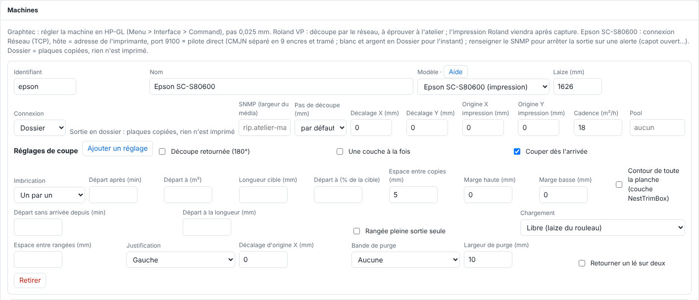

Le RIP ne pilote que les machines déclarées dans son catalogue. Cet article s'adresse à l'administrateur.

## Avant de commencer

Il vous faut un compte administrateur. La machine est branchée (voir la page de son modèle) et, si elle est en réseau, elle a une adresse fixe réservée sur le routeur.

## Étapes

1. Dans le client, ouvrez **Administration…**, vue **Système › Machines**.
2. Cliquez **Ajouter une machine**.
3. Choisissez le **modèle**. Le lien **Aide** à côté ouvre la page de cette machine.
4. Donnez un identifiant (minuscules, chiffres et `-`) et un nom.
5. Saisissez la laize.
6. Choisissez la connexion et renseignez ses champs (voir [Choisir la connexion d'une machine](rip-choisir-la-connexion-d-une-machine.md)).
7. Au besoin, réglez le **Décalage X / Y** de la découpe, la **Cadence (m²/h)** et le **Pool**.
8. Cliquez **Enregistrer** : la machine apparaît tout de suite dans les boutons d'impression, la file et la barre latérale.

## Bon à savoir

- L'identifiant nomme le dossier `sorties/<machine>/` et sert au renvoi depuis un autre RIP : ne le changez pas à la légère.
- Une machine qui a encore une sortie à passer ne peut pas être retirée : passez ou annulez la sortie d'abord.
- Le **Décalage X / Y** (−20 à 20 mm) corrige l'écart mesuré sur une coupe d'essai entre la découpe et l'impression.
- Avec le même **Pool** sur des machines identiques (même modèle, même laize), un bouton **Imprimer sur pool** apparaît sur chaque page.
- Pour une découpeuse, **Dupliquer (autre jeu de repères)** crée une variante de la même machine physique.
- Chaque champ de la fiche est décrit dans [Comprendre les champs d'une machine](rip-comprendre-les-champs-d-une-machine.md).
- Modèles pris en charge : Epson SC-S80600, Roland VersaCAMM VP-300 / VP-540, Mutoh Kona 1650, Graphtec FC7000. Pour un autre modèle, écrivez à contact@e-ko.rip avec la marque, le modèle et son branchement.

## Voir aussi

- [Choisir la connexion d'une machine](rip-choisir-la-connexion-d-une-machine.md)
- [Connaître les machines prises en charge](rip-connaitre-les-machines-prises-en-charge.md)
- [La découpe est décalée par rapport à l'impression](../rip-depannage/rip-decoupe-decalee.md)
