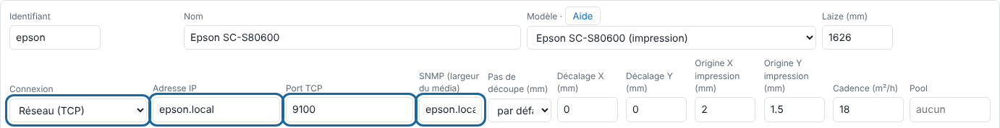
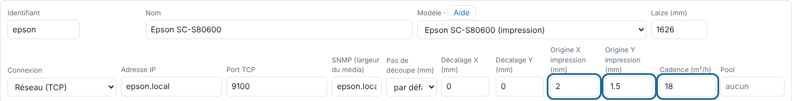

Le RIP rend les plaques, les sépare sur les 9 encres de l'Epson, les trame et envoie l'impression lui-même (pilote direct). Cet article décrit le branchement et les réglages.

## Avant de commencer

Il vous faut un compte administrateur, l'Epson câblée au réseau du serveur avec une adresse fixe, et le support enregistré dans l'imprimante sous un numéro.

## Étapes

1. Branchez l'Epson par câble réseau et réservez-lui une adresse fixe.
2. Dans le client, ouvrez **Administration…**, vue **Système**, section **Machines**, et ajoutez la machine avec **Ajouter une machine** (voir [Ajouter une machine](rip-ajouter-une-machine.md)).
3. Dans **Connexion**, choisissez **Réseau (TCP)**, saisissez l'adresse de l'Epson dans **Adresse IP** et gardez le **Port TCP** 9100 : c'est le pilote direct.
4. Renseignez l'adresse **SNMP (largeur du média)** : l'Epson donne alors sa largeur de média, son support chargé, ses encres et ses alertes.

   
5. Réglez l'**Origine X impression (mm)** et l'**Origine Y impression (mm)** sur un essai papier, et la **Cadence (m²/h)** mesurée à l'atelier.

   
6. Cliquez **Enregistrer**, en bas de la section **Machines**.
7. Dans la section **Supports de l'Epson**, déclarez vos supports avec le numéro enregistré dans l'imprimante.
8. Vérifiez depuis le serveur : `nc -vz <adresse-de-l-epson> 9100`.
9. Descendez à la section **Média chargé dans l'Epson** : la laize, le rouleau restant et les encres doivent s'afficher.

## Bon à savoir

- Connexion **IPP** (file CUPS raw) et **Renvoi** donnent le même flux. En connexion **Dossier**, rien n'est imprimé : un fichier par canal (`K.tif`… `WH.tif`) et `envoi.json` sont déposés dans `sorties/<machine>/`.
- Le blanc et l'argent ne passent pas encore par le pilote direct : en connexion réseau, la mise en file est refusée (« Envoi à l'imprimante impossible »). Utilisez en attendant une machine en connexion **Dossier**.
- Une alerte bloquante lue par SNMP (capot ouvert…) arrête l'envoi : « L'imprimante signale une alerte : impression arrêtée ». Levez-la, puis **Refaire**.
- Sortie en attente « Autre support » : le support chargé n'est pas celui du travail ; chargez le bon, ou choisissez le support chargé à la main.
- Pas de largeur de média : vérifiez l'adresse SNMP, que l'Epson est allumée et sur le même réseau, et la communauté (`public` par défaut).

## Voir aussi

- [Régler un support et ses modes d'impression](../rip-couleur/rip-regler-un-support-et-ses-modes.md)
- [La sortie vers la machine a échoué](../rip-depannage/rip-sortie-vers-la-machine-echouee.md)
- [Comprendre le pilote direct de l'Epson](rip-comprendre-le-pilote-direct-de-l-epson.md)
