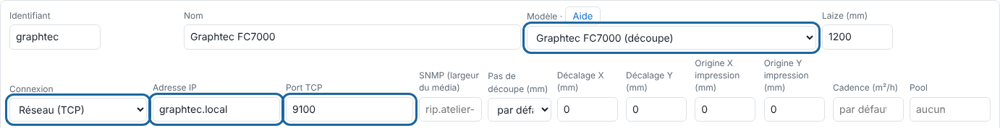

Le RIP envoie la découpe à la Graphtec FC7000 en HP-GL, au pas de 0,025 mm.

## Avant de commencer

Il vous faut un compte administrateur. La machine est en réseau avec une adresse fixe, ou branchée en série ou USB-série.

## Étapes

1. Sur la Graphtec, réglez les commandes en **HP-GL** : Menu > Interface > Command.
2. Réglez le repérage **ARMS** au panneau de la machine.
3. Réservez une adresse fixe pour la machine.
4. Dans le client, ouvrez **Administration…**, vue **Système**, section **Machines**, cliquez **Ajouter une machine** et choisissez le modèle **Graphtec FC7000 (découpe)**.
5. Dans **Connexion**, choisissez **Réseau (TCP)** (ou **Série / USB-série**) et saisissez l'adresse dans **Adresse IP** et le **Port TCP**.

   
6. Vérifiez le **Pas de découpe (mm)** (0,025 mm), les réglages de coupe et le **Décalage X / Y**, puis cliquez **Enregistrer**.
7. Vérifiez depuis le serveur : `nc -vz <adresse-de-la-graphtec> <port>`.

## Bon à savoir

- Rien ne coupe : l'interface de la machine n'est pas en HP-GL.
- Sortie en échec, machine injoignable : vérifiez l'adresse, le port et le câble.
- Si la découpe est décalée par rapport à l'impression, mesurez l'écart sur une coupe d'essai et saisissez le **Décalage X / Y**.

## Voir aussi

- [Ajouter une machine au RIP](rip-ajouter-une-machine.md)
- [La découpe est décalée par rapport à l'impression](../rip-depannage/rip-decoupe-decalee.md)
- [Choisir la connexion d'une machine](rip-choisir-la-connexion-d-une-machine.md)
- Page détaillée : https://e-ko.rip/documentation/machines/graphtec-fc7000/
