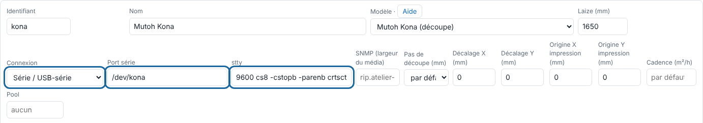

Le RIP envoie la découpe au Kona comme le fait le logiciel du constructeur (HP-GL, pas de 0,01 mm), avec lecture du cadre et du code-barres pour le repérage.

## Avant de commencer

Il vous faut un compte administrateur et un port USB libre sur le serveur. Le service du RIP a déjà le droit d'y écrire.

## Étapes

1. Branchez le Kona en USB (adaptateur série FTDI). Le paquet crée `/dev/kona` pour le groupe `dialout`.
2. Vérifiez le port : `ls -l /dev/kona`.
3. Sur le Kona, réglez la résolution à **0,010 mm**.
4. Dans le client, ajoutez la machine (**Administration… › Système › Machines › Ajouter une machine**) avec la connexion **Série / USB-série**, le **Port série** `/dev/kona` et le réglage **stty** `9600 cs8 -cstopb -parenb crtscts raw -echo`.

   
5. Réglez le pas de découpe à 0,01 mm et les **réglages de coupe** (vitesse, force, accélération, outil, motif) ; le premier sert par défaut.
6. À l'envoi d'un travail, choisissez le **Repérage Kona**. Le cadre avec code-barres (type 2) est celui éprouvé à l'atelier.
7. Faites une coupe d'essai, mesurez l'écart et saisissez-le en **Décalage X / Y**.

## Bon à savoir

- Engagez dans le Kona le bord que montre la flèche ▲ du cadre.
- Si la coupe sort tournée de 180°, cochez **Découpe retournée**.
- `/dev/kona` absent : débranchez, rebranchez, puis consultez `journalctl -k | tail`.
- Arrêt sur « EPOS 6213 » : un cadre de type 1, sans code-barres, a été envoyé directement ; le Kona ne le lit pas seul. Prenez le type 2.
- Avec un repérage Kona, les traits de coupe et les croix ne sont pas imprimés (ils gêneraient la lecture) : une alerte le dit.
- Pour une page de 1,5 m et plus dans le sens d'avance, le type 2 prend seul le cadre multi-segments.

## Voir aussi

- [La découpe est décalée par rapport à l'impression](../rip-depannage/rip-decoupe-decalee.md)
- [Choisir le repérage Kona](rip-choisir-le-reperage-kona.md)
- [Régler la coupe du Kona](rip-regler-la-coupe-du-kona.md)
- [Ajouter une machine au RIP](rip-ajouter-une-machine.md)
