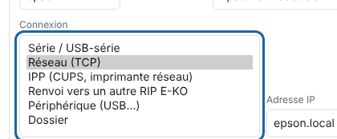

Le serveur parle aux machines par le réseau, en USB ou par un dossier. Cet article aide à choisir la connexion et à la contrôler.

## Avant de commencer

Vous êtes administrateur et la machine est en cours d'ajout (voir [Ajouter une machine](rip-ajouter-une-machine.md)). Pour les vérifications, vous avez un terminal sur le serveur.

## Étapes

1. Choisissez la connexion selon la machine :
   - **Réseau (TCP)** : Epson (pilote direct, port 9100), Graphtec, Roland ;
   - **Série / USB-série** : Kona ou découpeuse en USB-série (port `/dev/kona`) ;
   - **Périphérique (USB…)** : machine en USB imprimante (chemin `/dev/usb/lp0`…) ;
   - **Dossier** : logiciel tiers qui surveille un dossier ;
   - **IPP** : file CUPS **raw** ou imprimante IPP ;
   - **Renvoi vers un autre RIP E-KO** : machine branchée sur un autre serveur E-KO RIP Center.

   

2. Renseignez l'**Adresse IP** et le **Port TCP**, ou le chemin, dans la fiche de la machine.
3. Pour une machine en réseau, vérifiez qu'elle répond depuis le serveur : `nc -vz <adresse-de-la-machine> <port>`.
4. Pour un port USB, vérifiez qu'il existe : `ls -l <port>`.
5. Pour IPP, créez d'abord une file **raw** dans CUPS (`lpadmin -p epson -v socket://<adresse-de-l-imprimante>:9100 -E`), puis saisissez le chemin `/printers/epson` et le port 631. Vérifiez avec `lpstat -h <hôte> -p`.
6. Pour un renvoi, créez le jeton sur le serveur qui reçoit : `sudo -u eko-rip env EKO_RIP_DATA=/var/lib/eko-rip eko-rip-serveur renvoi jeton`. Collez-le dans la machine **Renvoi** du serveur qui envoie (port 8640).

## Bon à savoir

- Le jeton de renvoi ne s'affiche qu'une fois. `renvoi etat` dit s'il est ouvert, `renvoi retirer` ferme le renvoi.
- Le flux de renvoi passe en clair sur le réseau local : gardez-le entre serveurs de l'atelier.
- En connexion **Dossier**, rien n'est imprimé : les fichiers sont déposés dans `sorties/<machine>/`.
- Une file CUPS arrêtée ou introuvable fait échouer la sortie avec le refus IPP en clair.

## Voir aussi

- [Ajouter une machine au RIP](rip-ajouter-une-machine.md)
- [La sortie vers la machine a échoué](../rip-depannage/rip-sortie-vers-la-machine-echouee.md)
- [Brancher la Mutoh Kona 1650](rip-brancher-mutoh-kona-1650.md)
- Page détaillée : https://e-ko.rip/documentation/machines/
