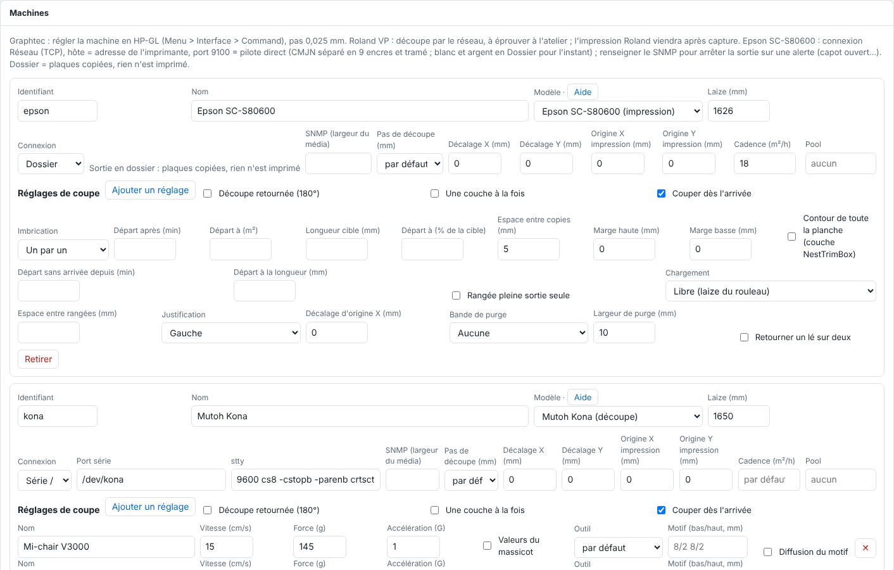

La fiche d'une machine regroupe tous ses réglages. Cet article décrit chaque champ, pour l'administrateur.

## Avant de commencer

Il vous faut un compte administrateur. Ouvrez **Administration…**, vue **Système**, section **Machines**.

## Étapes

1. Lisez le tableau des champs communs.

   

   | Champ | Rôle |
   |---|---|
   | **Identifiant** | Minuscules, chiffres, `-`. Il nomme le dossier `sorties/<machine>/` et sert au renvoi d'un autre RIP : ne le changez pas à la légère. |
   | **Nom** | Le nom affiché. |
   | **Modèle** | Epson SC-S80600, Mutoh Kona, Graphtec FC7000 ou Roland VersaCAMM VP. Le lien **Aide** ouvre la page de la machine. |
   | **Laize (mm)** | La largeur utile. |
   | **Connexion** | Série ou USB-série, réseau TCP, périphérique (comme `/dev/usb/lp0`), dossier, IPP ou renvoi. |
   | **SNMP (largeur du média)** | Adresse pour lire le média chargé. |
   | **Pas de découpe (mm)** | 0,01 mm pour le Kona, 0,025 mm par défaut ailleurs. |
   | **Décalage X / Y (mm)** | De −20 à 20 mm : l'écart mesuré sur une coupe d'essai entre la découpe et l'impression, ajouté à chaque découpe envoyée à cette machine. |
   | **Origine X / Y impression (mm)** | Place l'image sur la page (Epson, pilote direct). |
   | **Cadence (m²/h)** | Pour estimer les durées. |
   | **Pool** | Nom commun à des machines identiques. |

2. Pour une découpeuse, lisez aussi : ses **Réglages de coupe**, **Découpe retournée (180°)**, **Une couche à la fois**, **Couper dès l'arrivée** et **Dupliquer (autre jeu de repères)**.
3. Pour une imprimante, lisez son **Imbrication** (voir [Régler l'imbrication d'une imprimante](rip-regler-l-imbrication-d-une-imprimante.md)).
4. Cliquez **Enregistrer** : l'enregistrement applique tout de suite ; les boutons d'impression et de découpe, la file et la barre latérale suivent.

## Bon à savoir

- Une machine qui a encore une sortie à passer ne peut pas être retirée du catalogue.
- Identifiant : minuscules, chiffres et `-` seulement.
- **Cadence (m²/h)** : l'Epson a par défaut 94 m²/h jusqu'à 360 dpi, 17 m²/h à 720 dpi (720 × 1440, 6 passes), 6,6 m²/h au-delà ; la valeur saisie la remplace (à mesurer à l'atelier, et pour la Roland). L'estimation d'une durée : longueur imprimée × laize de la machine ÷ cadence.
- **Origine X / Y impression** : X depuis le bord de référence de la laize (arrondi à 16 points), Y ajouté à la tête vide. 0 par défaut, à régler sur un essai papier.
- Une adresse IP fixe est conseillée pour toute machine en réseau.

## Voir aussi

- [Ajouter une machine au RIP](rip-ajouter-une-machine.md)
- [Choisir la connexion d'une machine](rip-choisir-la-connexion-d-une-machine.md)
- [Regrouper des imprimantes en pool](rip-regrouper-des-imprimantes-en-pool.md)
