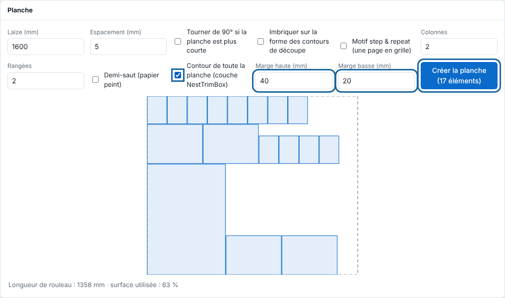

Aucune table de découpe n'est encore pilotée directement par le RIP, mais il prépare déjà les planches qui leur sont destinées.

## Avant de commencer

Vos pages sont des PDF à imbriquer sur une planche (voir [Créer une planche](../rip-travaux/rip-creer-une-planche.md)).

## Étapes

1. Dans le panneau **Planche**, cochez **Contour de toute la planche (couche NestTrimBox)**. Un rectangle de découpe est ajouté autour des éléments posés.
2. Réglez la **Marge haute (mm)** pour laisser du blanc au-dessus des éléments.
3. Réglez la **Marge basse (mm)** pour laisser du blanc au-dessous (0 à 200 mm pour chaque marge).
4. Cliquez **Créer la planche**.

   
5. Pour une planche faite par l'imbrication de la file, réglez les mêmes options dans la section **Machines** de la vue **Système**, à la fiche de l'imprimante : **Marge haute (mm)**, **Marge basse (mm)** et **Contour de toute la planche (couche NestTrimBox)**.

   

## Bon à savoir

- Le contour est dans sa propre couche `NestTrimBox`, coupé en dernier et jamais imprimé.
- Aucune table de découpe n'est encore pilotée directement par le RIP : chaque table prise en charge aura son article dans cette famille, comme les imprimantes et les plotters. Pour demander la prise en charge d'une table, écrivez à [contact@e-ko.rip](mailto:contact@e-ko.rip) avec la marque, le modèle et le logiciel de la table.
- Détail de la planche : [Affiner une planche : formes, répétition et contour global](../rip-travaux/rip-affiner-une-planche.md).

## Voir aussi

- [Créer une planche pour regrouper des impressions](../rip-travaux/rip-creer-une-planche.md)
- [Ajouter une machine au RIP](rip-ajouter-une-machine.md)
- [Gérer la file d'une machine](../rip-travaux/rip-gerer-la-file-d-une-machine.md)
