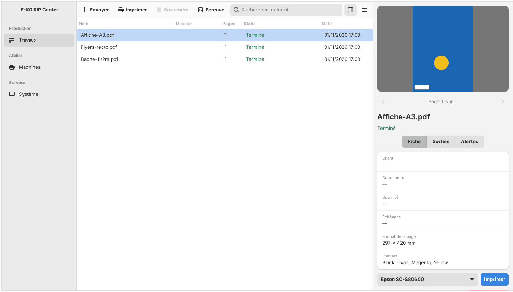
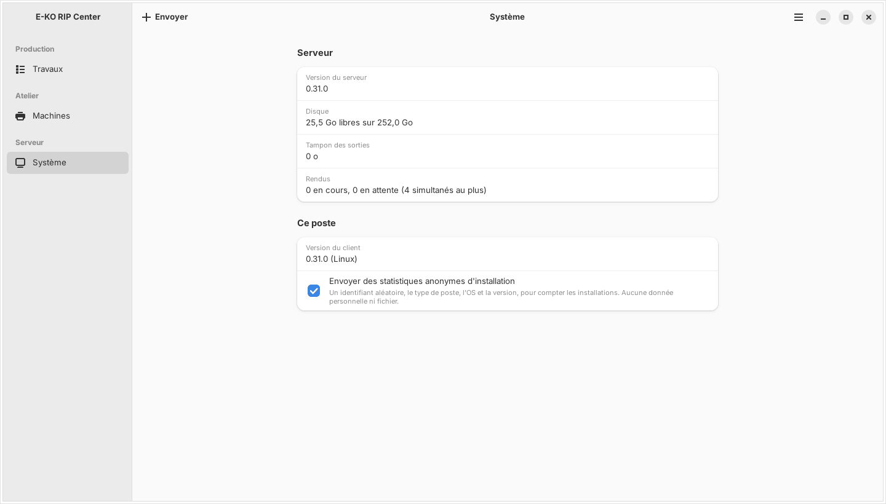

Le client E-KO RIP Center est le logiciel des postes de travail : vous y envoyez les fichiers, suivez les travaux et la file, lancez les impressions et les découpes. Cet article présente sa fenêtre, identique dans ses grandes lignes sur Mac, Linux et Windows.

## Avant de commencer

Le client est installé et connecté à un serveur (voir [Se connecter au serveur depuis un poste](rip-se-connecter-au-serveur.md)). Tous les clients parlent au même serveur et voient la même file.

## Étapes

1. Repérez la **barre latérale**, à gauche : **Travaux**, **Machines** et **Système**.
2. Au centre, lisez le **tableau des travaux** : nom, dossier, pages, état et date. Une zone de recherche permet de filtrer la liste.
3. Cliquez un travail : l'**inspecteur**, à droite, affiche l'aperçu, la fiche, les plaques d'encre et les alertes.
4. Utilisez les actions de l'inspecteur : **Imprimer**, **Relancer**, **Épreuve TIFF**, **Supprimer**.
5. Ouvrez **Machines** pour voir la file de chaque imprimante et découpeuse.
6. Ouvrez **Système** pour lire la version du serveur, l'espace disque, le tampon des sorties, les rendus en cours et la version du client.
7. Pour les réglages complets (machines, supports, couleur, découpe, comptes, sauvegarde, Cloud), ouvrez **Administration…** dans le menu.

## Bon à savoir

- **Où trouver les menus.** Sur Mac : **Serveur › Changer de serveur…**, **Serveur › Administration…**, **Serveur › Se déconnecter**, **Aide › Signaler un problème…**. Sur Linux : bouton ☰ en haut à droite, avec **Administration…**, **Signaler un problème…**, **Changer de serveur…**, **Se déconnecter** et **À propos d'E-KO RIP Center**. Sur Windows : bouton **…** de la barre d'outils, avec **Actualiser** (F5), **Administration…**, **Changer de serveur…**, **Se déconnecter**, **Aide / Documentation** (F1) et **À propos d'E-KO RIP Center**.
- Sous Windows, les liens externes de la fenêtre d'administration s'ouvrent dans le navigateur par défaut.
- Le client Windows reprend l'interface des clients Mac et Linux. À l'envoi, son réglage par défaut est **Sans réglage** : le serveur applique alors ses réglages par défaut.
- Dans la vue **Système**, la case d'envoi de statistiques anonymes (identifiant aléatoire, type de poste, système et version, sans donnée personnelle ni fichier) se décoche à tout moment.
- Ouvrir `http://<adresse-du-serveur>:8640` dans un navigateur n'affiche qu'une page d'état : l'interface et l'API sont réservées au client.

## Voir aussi

- [Envoyer un travail au RIP](../rip-travaux/rip-envoyer-un-travail.md)
- [Suivre les travaux et lancer l'impression](../rip-travaux/rip-suivre-les-travaux.md)
- [Se connecter au serveur depuis un poste](rip-se-connecter-au-serveur.md)
