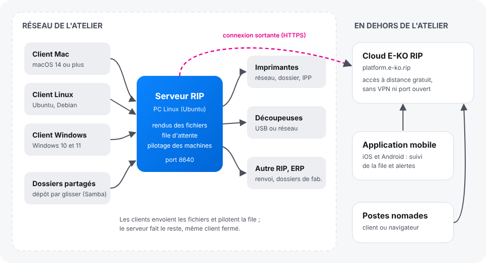

E-KO RIP Center est un RIP d'impression grand format libre et gratuit. Un serveur installé sur un PC Linux de l'atelier reçoit les fichiers, calcule les rendus et pilote les imprimantes et les découpeuses. Cet article présente les cinq pièces du RIP et ce qu'il faut savoir avant de commencer.

## Avant de commencer

Rien à installer pour lire cet article. Il s'adresse à toute personne qui découvre le RIP : responsable d'atelier, opérateur, administrateur.

## Étapes

1. Repérez les cinq pièces dans le tableau ci-dessous et le schéma qui suit.

   | Pièce | Où | Rôle |
   |---|---|---|
   | **Serveur RIP** | un PC Linux de l'atelier, allumé en permanence | reçoit les fichiers, calcule les rendus, tient la file d'attente, pilote les machines |
   | **Client E-KO RIP Center** | chaque poste de travail (Mac, Linux, Windows) | envoie les fichiers, suit les travaux, lance les impressions et les découpes |
   | **Application mobile** | téléphone iOS ou Android | suit la file et les machines, reçoit les alertes (cartouche vide, machine injoignable…) |
   | **Cloud E-KO RIP** | service en ligne, `platform.e-ko.rip` | donne accès au serveur depuis l'extérieur, sans VPN ni port ouvert |
   | **Interface d'administration** | dans le client (**Administration…**) ou par le Cloud dans un navigateur | réglages des machines, supports, couleur, comptes, sauvegarde |

   
2. Retenez que tout le travail se fait sur le serveur. Les clients envoient les fichiers et affichent la file : une fois un fichier envoyé, vous pouvez fermer le client, le rendu et l'impression continuent.
3. Retenez qu'un seul serveur sert tout l'atelier. Tous les postes, Mac, Linux ou Windows, voient la même file et les mêmes machines.
4. Retenez que le serveur reste dans l'atelier. Il n'est jamais exposé sur Internet : pour y accéder de l'extérieur, passez par le Cloud E-KO RIP, gratuit.
5. Passez ensuite à l'installation, dans l'ordre décrit par [Installer un atelier RIP en cinq étapes](rip-installer-un-atelier-en-cinq-etapes.md).

## Bon à savoir

- Le logiciel est libre : le code est public sous licence AGPL-3.0 sur [GitHub](https://github.com/mvignaud/eko-rip-center). Aucune licence à acheter, aucun nombre de postes limité.
- Un navigateur ouvert sur l'adresse du serveur, dans l'atelier, n'affiche qu'une **page d'état** (version, machines, adresse à saisir dans le client) : l'interface complète est réservée aux clients.

  
- Les mots du métier (plaque, laize, BAT, repérage…) sont expliqués dans le [glossaire](rip-consulter-le-glossaire.md).
- Cette aide suit la dernière version publiée ; les nouveautés de chaque version sont dans le [journal des versions](https://e-ko.rip/changelog/).

Pour trouver votre article selon ce que vous voulez faire :

| Je veux… | Lire |
|---|---|
| Comprendre l'ensemble et installer un atelier pas à pas | [Installer un atelier RIP en cinq étapes](rip-installer-un-atelier-en-cinq-etapes.md) |
| Installer le serveur sur un PC Linux | [Installer le serveur RIP](rip-installer-le-serveur.md) |
| Installer le logiciel sur mon Mac, mon PC Linux ou Windows | [Installer le client sur Mac](rip-installer-le-client-mac.md), [sur Linux](rip-installer-le-client-linux.md), [sur Windows](rip-installer-le-client-windows.md) |
| Suivre la production sur mon téléphone | [Installer l'application mobile](rip-installer-l-application-mobile.md) |
| Accéder à l'atelier depuis chez moi ou un client | [Relier le serveur au Cloud](../rip-cloud-premiers-pas/rip-cloud-relier-un-serveur.md) |
| Envoyer un fichier, imprimer, découper, faire un BAT | [Envoyer un travail](../rip-travaux/rip-envoyer-un-travail.md) |
| Brancher et régler une machine | [Ajouter une machine](../rip-machines/rip-ajouter-une-machine.md) |
| Gérer les comptes, sauvegarder, mettre à jour | [Créer les comptes du serveur](../rip-administration/rip-creer-les-comptes.md) |
| Comprendre un message d'erreur | [Le client ne trouve pas le serveur](../rip-depannage/rip-client-ne-trouve-pas-le-serveur.md) et les autres articles de la rubrique Dépannage |

## Voir aussi

- [Installer un atelier RIP en cinq étapes](rip-installer-un-atelier-en-cinq-etapes.md)
- [Choisir le poste serveur](rip-choisir-le-poste-serveur.md)
- [Consulter le glossaire du RIP](rip-consulter-le-glossaire.md)
- [Signaler un problème à l'équipe](../rip-depannage/rip-signaler-un-probleme.md)
