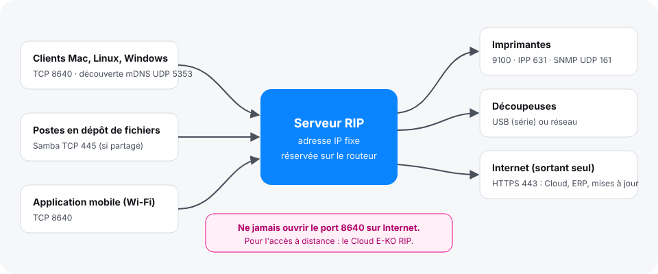

Le serveur écoute un seul port pour les clients et en joint quelques autres vers les machines et vers Internet. Cet article liste ces ports pour la personne qui règle le routeur ou le pare-feu.

## Avant de commencer

Vous avez accès au routeur ou au pare-feu de l'atelier. Si le serveur a son propre pare-feu, vous avez aussi un accès administrateur sur le serveur.

## Étapes

1. Repérez dans le schéma ce que le serveur écoute (à gauche) et ce qu'il joint (à droite).

   
2. Laissez passer les ports du tableau.

   | Sens | Port | Pour |
   |---|---|---|
   | Postes → serveur | TCP **8640** | clients, application mobile dans l'atelier, renvoi entre RIP |
   | Postes ↔ serveur | UDP 5353 (mDNS) | découverte automatique du serveur par les clients |
   | Postes → serveur | TCP 445 | dossiers surveillés partagés (Samba), si vous les partagez |
   | Serveur → imprimantes | TCP 9100, 631 (IPP), UDP 161 (SNMP) | envoi des travaux, niveaux d'encre, média chargé |
   | Serveur → Internet | TCP 443 (HTTPS, sortant) | mises à jour, Cloud E-KO RIP, ERP |
3. Réservez une adresse IP fixe au serveur, aux imprimantes en réseau et aux découpeuses en réseau (bail DHCP fixe sur le routeur ou saisie à la main).
4. Si les clients ne trouvent pas le serveur, vérifiez que le port TCP 8640 et le port UDP 5353 passent sur le pare-feu du serveur.

## Bon à savoir

> N'ouvrez jamais le port 8640 sur Internet : la connexion n'est pas chiffrée (HTTP), le serveur ne doit être joignable que depuis le réseau de l'atelier. Pour travailler à distance, utilisez le [Cloud E-KO RIP](../rip-cloud-premiers-pas/rip-cloud-acceder-a-distance.md) : le serveur ouvre lui-même une connexion sortante, aucun port à ouvrir.

- Pourquoi une adresse fixe : les clients, les dossiers partagés (Samba), un autre RIP en renvoi et l'ERP joignent le serveur par son adresse ; l'Epson est joint pour le pilote direct (port 9100) et la lecture SNMP ; les découpeuses en réseau (Graphtec, Roland) et un serveur CUPS ou un autre RIP E-KO sont saisis par leur adresse dans **Système › Machines**.
- Préférez un câble au Wi-Fi entre le serveur et les machines.
- La découverte automatique (mDNS) ne traverse ni les routeurs, ni les VPN, ni certains réseaux Wi-Fi invités : saisissez alors l'adresse dans le client. Pour ne pas du tout s'annoncer sur le réseau, voir `EKO_RIP_ANNONCE` dans [Modifier les réglages avancés du serveur](../rip-administration/rip-modifier-les-reglages-avances-du-serveur.md).
- L'ERP et le dépôt de paquets sont joints en HTTPS sortant : rien à ouvrir à l'entrée.

## Voir aussi

- [Le client ne trouve pas le serveur](../rip-depannage/rip-client-ne-trouve-pas-le-serveur.md)
- [Choisir le poste serveur](rip-choisir-le-poste-serveur.md)
- [Choisir la connexion d'une machine](../rip-machines/rip-choisir-la-connexion-d-une-machine.md)
- [Partager les dossiers surveillés](../rip-administration/rip-partager-les-dossiers-surveilles.md)
