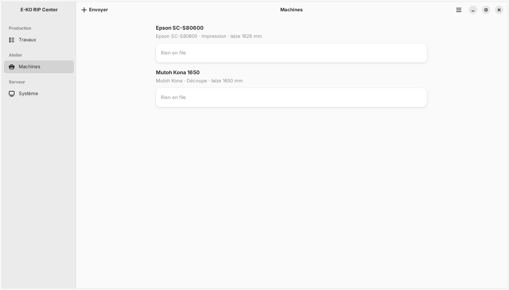

Le client E-KO RIP Center est le logiciel des postes de travail : vous y envoyez les fichiers et suivez les travaux. Cet article décrit son installation sur Linux.

## Avant de commencer

Il vous faut Ubuntu 24.04 ou plus récent, ou Debian 13 (bureau GNOME conseillé), sur un PC 64 bits, avec un accès `sudo`. Comptez 5 minutes.

## Étapes

1. Ouvrez un terminal.
2. Lancez l'installation, qui ajoute aussi le dépôt E-KO au système :
   `wget -qO- https://apt.e-ko.fr/rip/installer | sudo sh`
3. Ouvrez les applications et lancez **E-KO RIP Center**.
4. Choisissez votre serveur dans l'écran de connexion (voir [Se connecter au serveur](rip-se-connecter-au-serveur.md)).

## Bon à savoir

- Le script ajoute la clé du dépôt et un fichier de source APT (`/etc/apt/sources.list.d/eko-rip.list`), puis installe le client.
- Des fichiers `.deb` et `.AppImage` sont aussi disponibles sur la page des releases, pour les postes sans accès au dépôt.
- Le client se met ensuite à jour avec le reste du système : `sudo apt update && sudo apt upgrade`.
- Le menu principal (bouton ☰ en haut à droite) donne **Administration…**, **Signaler un problème…**, **Changer de serveur…**, **Se déconnecter** et **À propos d'E-KO RIP Center**.
- Un PC peut être à la fois serveur et poste de travail : le même dépôt sert aux deux, il suffit ensuite d'installer le paquet `eko-rip-serveur`.

## Voir aussi

- [Se connecter au serveur depuis un poste](rip-se-connecter-au-serveur.md)
- [Installer le serveur RIP](rip-installer-le-serveur.md)
- [Envoyer un travail au RIP](../rip-travaux/rip-envoyer-un-travail.md)
- [Comprendre la fenêtre du client et ses menus](rip-comprendre-la-fenetre-du-client.md)
