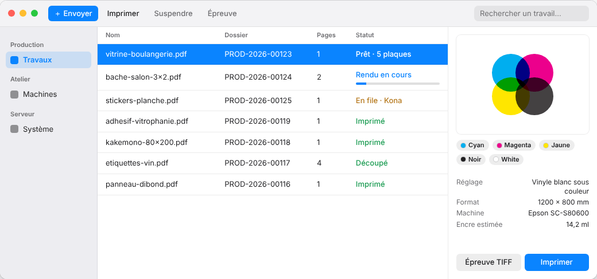

Le client E-KO RIP Center est le logiciel des postes de travail : vous y envoyez les fichiers et suivez les travaux. Cet article décrit son installation sur Mac.

## Avant de commencer

Il vous faut macOS 14 (Sonoma) ou plus récent, sur un Mac Apple Silicon ou Intel. Le serveur doit déjà tourner dans l'atelier. Comptez 5 minutes.

## Étapes

1. Ouvrez https://e-ko.rip/telecharger/mac et téléchargez le fichier `.dmg` de la dernière version.
2. Ouvrez le fichier `.dmg`.
3. Glissez **E-KO RIP Center** dans **Applications**.
4. Lancez l'application. Elle est signée et vérifiée par Apple : elle s'ouvre sans avertissement.
5. Quand macOS demande l'accès au **réseau local**, acceptez.
6. Choisissez votre serveur dans l'écran de connexion (voir [Se connecter au serveur](rip-se-connecter-au-serveur.md)).

## Bon à savoir

- Sans l'accès au réseau local, le client ne trouve pas le serveur. Vous pouvez l'accorder après coup dans Réglages Système › Confidentialité et sécurité › Réseau local.
- Pour mettre à jour, téléchargez la nouvelle version et remplacez l'application. Un client un peu plus ancien que le serveur continue de fonctionner.
- Menus utiles : **Serveur › Changer de serveur…**, **Serveur › Administration…**, **Serveur › Se déconnecter** et **Aide › Signaler un problème…**.

## Voir aussi

- [Se connecter au serveur depuis un poste](rip-se-connecter-au-serveur.md)
- [Envoyer un travail au RIP](../rip-travaux/rip-envoyer-un-travail.md)
- [Le client ne trouve pas le serveur](../rip-depannage/rip-client-ne-trouve-pas-le-serveur.md)
- Page détaillée : https://e-ko.rip/documentation/clients/
