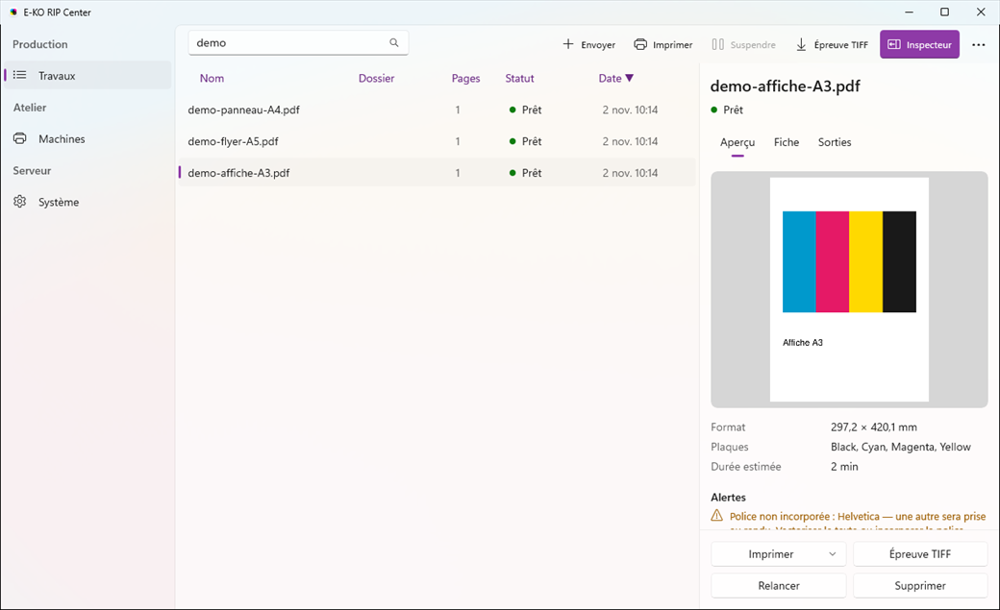

Le client E-KO RIP Center est le logiciel des postes de travail : vous y envoyez les fichiers et suivez les travaux. Cet article décrit son installation sous Windows.

## Avant de commencer

Il vous faut Windows 10 ou 11, 64 bits. Aucun droit d'administrateur n'est nécessaire : le client s'installe pour l'utilisateur courant. Comptez 5 minutes.

## Étapes

1. Ouvrez https://e-ko.rip/telecharger/#windows. La page donne la version, la taille et l'empreinte SHA-256 de l'installateur.
2. Suivez le lien vers la release GitHub et téléchargez le fichier qui se termine par `_x64-setup.exe`.
3. Lancez ce fichier et suivez l'assistant.
4. Si Windows affiche « Windows a protégé votre ordinateur », cliquez **Informations complémentaires**, puis **Exécuter quand même**.
5. Ouvrez **E-KO RIP Center** depuis le menu Démarrer.
6. Saisissez l'adresse du serveur dans l'écran de connexion (voir [Se connecter au serveur](rip-se-connecter-au-serveur.md)).

## Bon à savoir

- L'installateur existe en `E-KO.RIP.Center_<version>_x64-setup.exe` ou en `.msi`.
- L'avertissement de Windows n'apparaît qu'une fois par poste.
- Le client Windows ne cherche pas encore les serveurs sur le réseau : saisissez toujours l'adresse du serveur, sous la forme `<adresse-du-serveur>:8640`.
- Le client reprend l'interface des clients Mac et Linux, avec la notification Windows quand un travail est prêt ; voir [Comprendre la fenêtre du client et ses menus](rip-comprendre-la-fenetre-du-client.md).
- Pour mettre à jour, téléchargez et lancez le nouvel installateur : il remplace l'ancienne version.
- Le menu (bouton **…**) donne **Actualiser**, **Administration…**, **Changer de serveur…**, **Se déconnecter**, **Aide / Documentation** et **À propos d'E-KO RIP Center**.

## Voir aussi

- [Se connecter au serveur depuis un poste](rip-se-connecter-au-serveur.md)
- [Envoyer un travail au RIP](../rip-travaux/rip-envoyer-un-travail.md)
- [Le client ne trouve pas le serveur](../rip-depannage/rip-client-ne-trouve-pas-le-serveur.md)
- [Windows affiche « Windows a protégé votre ordinateur »](../rip-depannage/rip-windows-protege-votre-ordinateur.md)
