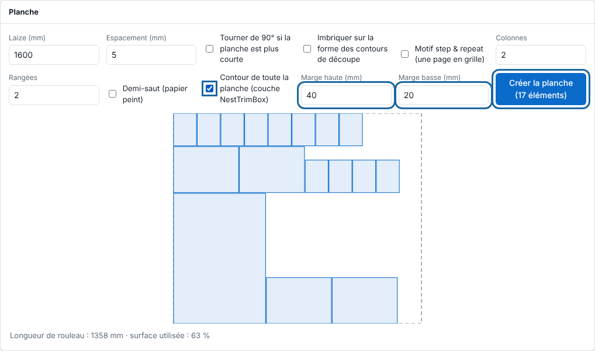

Le panneau **Planche** a plusieurs options pour serrer les pièces ou répéter un motif. Cet article complète la création d'une planche.

## Avant de commencer

Vous savez créer une planche (voir [Créer une planche pour regrouper des impressions](rip-creer-une-planche.md)).

## Étapes

1. Sur chaque page imprimable, cochez **Ajouter à la planche** et indiquez le nombre de copies.
2. Dans le panneau **Planche**, réglez la **laize** et l'**espacement**. L'imposition se dessine : le rouleau à la laize, chaque élément à sa place (survol : nom et dimensions), la longueur de rouleau et la part de surface utilisée.
3. Pour tourner les éléments, cochez **Tourner de 90° si la planche est plus courte** : quatre orientations sont essayées (telle quelle, tout tourné, tout couché, tout debout) et la plus courte en rouleau est gardée. Un élément plus large que la laize n'y passe que tourné.
4. Pour serrer les pièces, cochez **Imbriquer sur la forme des contours de découpe** : chaque élément occupe la place de son contour de découpe, plus l'espacement, au lieu de son rectangle (ronds en quinconce, triangles tête-bêche, avec les angles 0, 90, 180 et 270°).
5. Pour répéter une page en grille, cochez **Motif step & repeat**, réglez les **colonnes** et les **rangées**, et cochez **Demi-saut** pour décaler une colonne sur deux d'une demi-hauteur (raccord papier peint).
6. Cochez **Contour de toute la planche (couche NestTrimBox)** et réglez **Marge haute (mm)** et **Marge basse (mm)** (0 à 200) si la planche va sur une table de découpe.

   
7. Cliquez **Créer la planche** : la planche est un nouveau travail, avec la découpe de tous les contours.

## Bon à savoir

- Les éléments sont rangés du plus haut au plus bas, de gauche à droite. La résolution et le repérage du panneau Nouveau travail s'appliquent.
- Un élément sans contour fermé garde son rectangle. L'imposition dessine alors les contours.
- Le calcul se fait sur une grille de pas égal au 1/800 de la laize (1 mm au moins) : une découpe ne touche jamais sa voisine, mais l'espace réel peut dépasser l'espacement demandé d'un pas.
- La part de surface utilisée compte l'aire des contours de découpe, dans les deux modes.
- Avec **Motif step & repeat**, le nombre de copies coché est ignoré ; la grille doit tenir dans la laize (100 colonnes, 500 rangées et 2000 copies au plus). La découpe suit chaque copie.
- Une page qui porte des repères de découpe sans aucun tracé de coupe reçoit une alerte : encre et support pour rien.
- Le contour global est dans sa propre couche `NestTrimBox`, coupée en dernier et jamais imprimée.

## Voir aussi

- [Créer une planche pour regrouper des impressions](rip-creer-une-planche.md)
- [Préparer une planche pour une table de découpe](../rip-machines/rip-preparer-une-planche-pour-une-table-de-decoupe.md)
- [Composer une planche à la main ou avec des données variables](rip-composer-une-planche-par-l-api.md)
