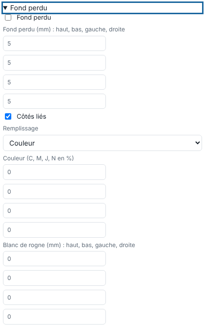

Le fond perdu évite un liseré blanc quand la coupe n'est pas parfaitement sur le bord de l'image. Cet article s'adresse aux opérateurs.

## Avant de commencer

Vous êtes à l'envoi d'un fichier, ou dans l'édition d'un travail fini. Le bloc **Fond perdu** se trouve dans **Édition rapide**.

## Étapes

1. Ouvrez le bloc **Fond perdu** et cochez **Fond perdu**.
2. Saisissez le fond perdu des quatre côtés (haut, bas, gauche, droite), jusqu'à 100 mm. Laissez **Côtés liés** coché pour la même valeur partout.
3. Choisissez le **Remplissage** : une **Couleur** (C, M, J, N en %), le premier pixel du bord, le miroir de l'image, ou la duplication des bords.
4. Au besoin, saisissez un **Blanc de rogne** (haut, bas, gauche, droite) : blanc ajouté autour, au-delà du fond perdu.

   
5. Cliquez **Envoyer au RIP**.

## Bon à savoir

- Les tons de découpe ne sont pas recopiés dans le fond perdu.
- Les marques imprimées se posent hors du fond perdu (voir [Poser des œillets et des marques imprimées](rip-poser-des-oeillets-et-des-marques-imprimees.md)).
- Le contour de découpe rectangulaire peut se placer autour du fond perdu ou de la boîte de rognage (fond perdu + rogne) : voir [Régler l'édition rapide d'un travail](rip-regler-l-edition-rapide-d-un-travail.md).
- La marge s'agrandit d'elle-même pour loger le fond perdu.

## Voir aussi

- [Régler l'édition rapide d'un travail](rip-regler-l-edition-rapide-d-un-travail.md)
- [Poser des œillets et des marques imprimées](rip-poser-des-oeillets-et-des-marques-imprimees.md)
- [Envoyer un travail au RIP](rip-envoyer-un-travail.md)
