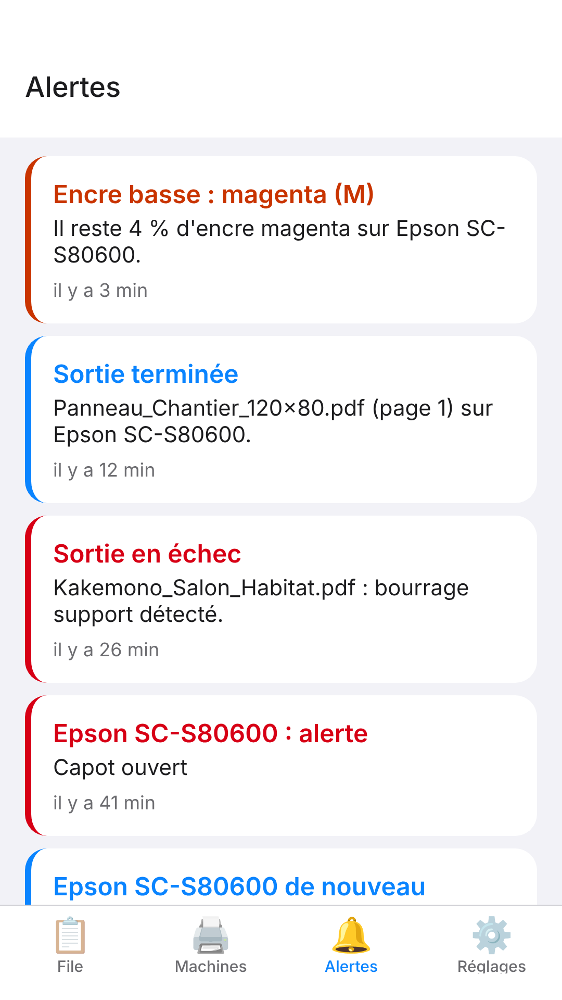

L'onglet **Alertes** garde la trace des derniers événements, pour retrouver ce qui s'est passé même si vous n'avez pas vu la notification.

## Avant de commencer

L'application est connectée au serveur.

## Étapes

1. Ouvrez l'onglet **Alertes**.
2. Repérez la pastille : elle signale les événements non encore vus.
3. Parcourez la liste, les plus récents en premier : chaque carte donne le titre, le détail (machine, fichier, message) et l'ancienneté.

## Bon à savoir

- L'historique garde les 200 derniers événements : alertes de machine, encre presque vide, sorties en échec, machine injoignable.
- Les alertes de la machine sont affichées en français ; un message que le RIP ne connaît pas encore reste dans la langue de la machine.
- Pour être prévenu sans ouvrir l'application, voir [Activer et régler les notifications de l'application mobile](rip-activer-les-notifications-de-l-application-mobile.md).

## Voir aussi

- [Activer et régler les notifications de l'application mobile](rip-activer-les-notifications-de-l-application-mobile.md)
- [Comprendre les événements notifiés par l'application mobile](rip-comprendre-les-evenements-notifies.md)
- [Un rendu échoue](../rip-depannage/rip-un-rendu-echoue.md)
