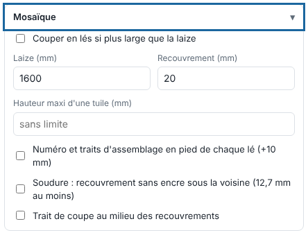

Quand un visuel dépasse la laize, la mosaïque le coupe en lés qui se collent ou se soudent à la pose. Cet article s'adresse aux opérateurs.

## Avant de commencer

Vous connaissez la laize utile du rouleau. Les réglages d'ensemble se font à l'envoi ; les lés inégaux se règlent dans la visionneuse.

## Étapes

1. Dans le panneau d'envoi, ouvrez le bloc **Mosaïque**.
2. Cochez **Couper en lés si plus large que la laize**, puis réglez la **Laize (mm)** et le **Recouvrement (mm)** : la zone imprimée sur les deux lés voisins, pour coller ou souder. Les lés ont d'abord la même largeur.

   
3. Cochez **Numéro et traits d'assemblage en pied de chaque lé (+10 mm)** : une bande de 10 mm porte « Lé 2/3 » et un trait vertical là où le lé voisin s'arrête ou commence, pour aligner les lés à la pose.
4. Au besoin, réglez la **Hauteur maxi d'une tuile (mm)** : la page est alors coupée en rangées (colonnes × rangées).
5. Cochez **Soudure : recouvrement sans encre sous la voisine (12,7 mm au moins)** si les lés se soudent, et **Trait de coupe au milieu des recouvrements** si la découpe doit suivre.
6. Cliquez **Envoyer au RIP** : chaque lé devient une page du travail, avec sa propre découpe rognée à son bord.
7. Pour des lés inégaux, ouvrez la page dans la visionneuse : le panneau **Lés** montre les lés en pointillés, leurs recouvrements teintés et leurs numéros.
   - Glissez un trait de lé (ou de rangée), ou saisissez la **Largeur des lés** et la **Hauteur des rangées** au mm ; **Lés égaux** revient au partage égal.
   - Cochez ou décochez **Tuiles à imprimer** : une tuile décochée n'est ni rendue ni mise en file. Cliquez le numéro d'une tuile pour régler son **recouvrement** propre (négatif = espace).
   - Saisissez l'**Ordre d'impression** (par exemple `3 1 2`) : ces tuiles d'abord, puis les autres par numéro.
8. Cliquez **Couper en lés** pour appliquer. Sur un travail déjà en lés, **Appliquer** garde les changements et **Page entière (sans mosaïque)** revient à une seule page.

## Bon à savoir

- Avec une mosaïque, **Tourner seul si le visuel dépasse la laize** est sans effet (les lés s'en chargent).
- Avec **Retourner un lé sur deux** (réglage de l'imprimante pour l'imbrication), les lés pairs sont posés à l'envers pour un raccord de teinte : voir [Régler l'imbrication d'une imprimante](../rip-machines/rip-regler-l-imbrication-d-une-imprimante.md).
- La grille (colonnes × rangées) se résume dans le panneau **Lés**.

## Voir aussi

- [Imprimer une étiquette et un QR code en marge](rip-imprimer-une-etiquette-et-un-qr-code.md)
- [Utiliser la visionneuse pour contrôler un travail](rip-utiliser-la-visionneuse.md)
- [Créer une planche pour regrouper des impressions](rip-creer-une-planche.md)
