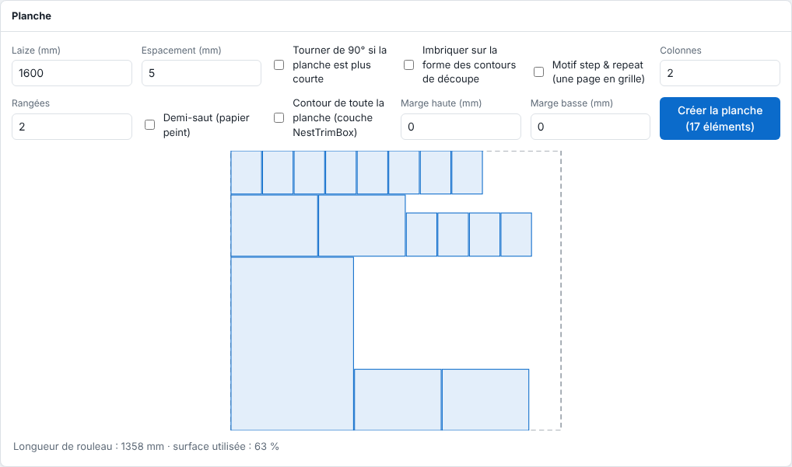

Une planche regroupe plusieurs éléments sur un seul rouleau pour gaspiller moins de support. Cet article décrit la création manuelle d'une planche.

## Avant de commencer

Vos travaux sont des PDF dont les pages sont plus étroites que la laize. Vous connaissez la largeur utile du rouleau.

## Étapes

1. Sur chaque page imprimable, cliquez le travail, cochez **Ajouter à la planche** dans l'inspecteur et indiquez le nombre de copies.

   
2. Dans le panneau **Planche**, au-dessus de la liste, réglez la **Laize (mm)** (1600 par défaut) et l'**Espacement (mm)**.
3. Regardez l'imposition dessinée : chaque élément à sa place, la longueur de rouleau et la part de surface utilisée.

   
4. Cochez **Tourner de 90° si la planche est plus courte** si vous acceptez la rotation des éléments.
5. Au besoin, cochez **Imbriquer sur la forme des contours de découpe** pour serrer les pièces.
6. Pour une destination de table de découpe, réglez **Marge haute (mm)** et **Marge basse (mm)**, ou cochez **Contour de toute la planche (couche NestTrimBox)**.
7. Cliquez **Créer la planche**. La planche devient un nouveau travail, avec la découpe de tous les contours.

## Bon à savoir

- Pour répéter une seule page en grille, utilisez le **Motif step & repeat** : colonnes, rangées, espacement et **Demi-saut**.
- Seuls les PDF s'imbriquent. Une page plus large que la laize n'entre dans aucune planche.
- Une imbrication automatique dans la file se règle par machine (**Système › Machines**, champ **Imbrication** : **Un par un**, **Groupé dans l'ordre** ou **Économie de support**). La planche en préparation apparaît alors dans la vue **File d'attente**, avec le bouton **Imprimer maintenant**.
- Des travaux ne partagent une planche que s'ils ont le même support, le même mode d'impression, la même découpeuse et le même miroir.

## Voir aussi

- [Préparer une planche pour une table de découpe](../rip-machines/rip-preparer-une-planche-pour-une-table-de-decoupe.md)
- [Affiner une planche : formes, répétition et contour global](rip-affiner-une-planche.md)
- [Suivre une planche en préparation dans la file](rip-suivre-une-planche-dans-la-file.md)
- [Envoyer un travail au RIP](rip-envoyer-un-travail.md)
