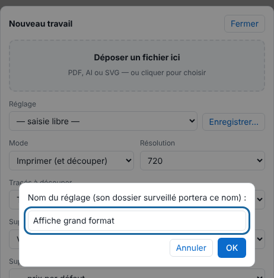
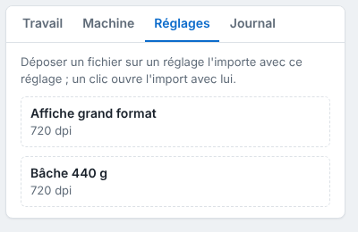

Chaque réglage enregistré a son dossier : un fichier déposé dedans devient un travail avec ce réglage, sans ouvrir le client. Cet article s'adresse aux postes qui envoient beaucoup de fichiers identiques.

## Avant de commencer

- Un réglage enregistré existe (bouton **Enregistrer…** du panneau d'envoi, compte administrateur pour les règles).
- Le dossier est accessible depuis votre poste (voir [Partager les dossiers surveillés](../rip-administration/rip-partager-les-dossiers-surveilles.md)).

## Étapes

1. Dans **Administration…**, vue **Production**, cliquez **Importer**, réglez le travail comme voulu, puis cliquez **Enregistrer…**, à côté de **Réglage**, et donnez un nom au réglage.

   
2. Vérifiez que le réglage figure dans l'onglet **Réglages**, à droite du tableau.

   
3. Ouvrez le dossier du réglage sur le serveur : `/var/lib/eko-rip/entrees/<nom du réglage>/`.
4. Déposez-y un PDF, AI, SVG, TIFF, PNG ou JPEG.
5. Attendez que la copie soit terminée (la taille doit rester stable 5 secondes) : le fichier devient un travail avec ce réglage.
6. Retrouvez le travail dans le tableau du client.

## Bon à savoir

- Vous pouvez aussi glisser un fichier sur le réglage dans l'onglet **Réglages** : il est importé avec ce réglage.
- Un fichier refusé est rangé dans `refuses/`, avec un fichier `.refus.txt` qui donne la raison.
- Le dossier automatique `/var/lib/eko-rip/entrees-auto/` choisit le réglage lui-même d'après des règles : voir [Régler le dossier automatique](rip-regler-le-dossier-automatique.md).
- Le nom du fichier peut porter le réglage, la machine, les copies, etc. : voir [Nommer un fichier avec des balises](rip-nommer-un-fichier-avec-des-balises.md).
- Les cases **Une page par travail** et **Refuser si une police manque** servent surtout aux dossiers surveillés : voir [Séparer les pages et refuser les fichiers douteux à l'arrivée](rip-trier-les-fichiers-a-l-arrivee.md).
- Le nom d'un réglage ne compte que des lettres, chiffres, espaces, `-`, `_` et `+`. Pour copier les réglages sur un autre serveur : [Exporter et importer les réglages enregistrés](rip-exporter-et-importer-les-reglages.md).
- Un réglage enregistré garde aussi la mise en file automatique : un dossier surveillé peut ainsi imprimer seul (voir [Mettre les pages en file automatiquement](rip-mettre-en-file-automatiquement.md)).
- Les dossiers surveillés ne demandent pas de compte du RIP : leur accès se règle par le partage du dossier.

## Voir aussi

- [Partager les dossiers surveillés](../rip-administration/rip-partager-les-dossiers-surveilles.md)
- [Envoyer un travail au RIP](rip-envoyer-un-travail.md)
- [Sauvegarder la configuration du serveur](../rip-administration/rip-sauvegarder-la-configuration.md)
