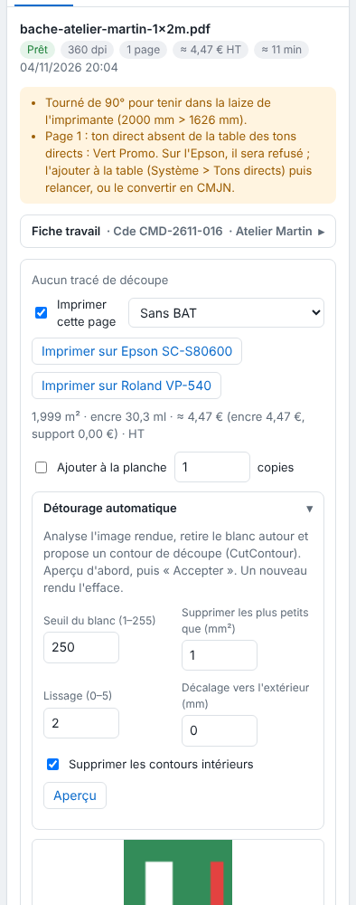

Quand le fichier n'a pas de tracé de découpe, le RIP peut en proposer un d'après l'image rendue. Cet article s'adresse aux opérateurs.

## Avant de commencer

Le travail est le rendu d'un PDF imprimé (le détourage ne s'applique pas aux autres formats).

## Étapes

1. Cliquez le travail, puis ouvrez le panneau **Détourage automatique** de la page imprimée dans l'inspecteur.

   
2. Réglez le **Seuil du blanc (1–255)**, **Supprimer les plus petits que (mm²)**, le **Lissage (0–5)** et le **Décalage vers l'extérieur (mm)**. Cochez **Supprimer les contours intérieurs** pour ne garder que le contour extérieur.
3. Cliquez **Aperçu** : le nombre de contours et leur dessin s'affichent.
4. Ajustez jusqu'à un contour satisfaisant, puis cliquez **Accepter** : les fichiers de coupe sont refaits.
5. Pour l'ôter, cliquez **Retirer le détourage**.

## Bon à savoir

- Le RIP retire le blanc autour de l'image et propose un contour de découpe (`CutContour`).
- Un nouveau rendu efface le détourage.
- Seul le rendu d'un PDF est concerné.

## Voir aussi

- [Comprendre le contrôle préalable de la découpe](rip-comprendre-le-controle-prealable-de-la-decoupe.md)
- [Étendre l'image près des tracés de découpe](rip-etendre-l-image-pres-des-traces-de-decoupe.md)
- [Mettre un travail en coupe](rip-mettre-en-coupe-un-travail.md)
