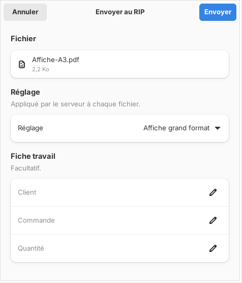

Un travail naît de l'envoi d'un fichier au RIP. Cet article montre comment l'envoyer avec les réglages voulus.

## Avant de commencer

Le client est connecté au serveur. Votre fichier est un PDF, un AI enregistré avec « Créer un fichier compatible PDF », un SVG (découpe seulement) ou une image TIFF, PNG ou JPEG. Sa taille ne dépasse pas 8 Go par défaut.

## Étapes

1. Dans le client, cliquez **+ Envoyer**, ou glissez le fichier sur la fenêtre (sur Mac, sur l'icône du Dock). Vous pouvez en déposer plusieurs : ils partent tous avec les mêmes réglages.
2. Choisissez le **Réglage** à appliquer, ou un réglage enregistré.
3. Choisissez le **Mode** : **Imprimer (et découper)** ou **Découper seulement**.
4. Réglez la **Résolution** (360, 720 ou 1440 dpi) et le **Support et mode d'impression**.
5. Si le travail se découpe, réglez les **Tracés à découper** et la **Découpeuse**.
6. Au besoin, renseignez le client, la commande et la quantité.
7. Cliquez **Envoyer au RIP**.
8. Attendez la notification qui annonce que le rendu est prêt, puis cliquez le travail dans le tableau pour voir son aperçu.

## Bon à savoir

- Le serveur signale dès l'envoi les polices non incorporées et les images de moins de 100 ppi à leur taille imprimée. Le travail part quand même : c'est à vous de juger.
- Une image est posée à sa taille réelle, d'après la résolution enregistrée dans le fichier. Sans résolution, le RIP compte 72 ppi et le travail le signale.
- Si la page est plus large que la laize mais tient tournée de 90°, le RIP la tourne et l'indique par une alerte (case **Tourner seul si le visuel dépasse la laize**, cochée par défaut).
- Le bouton **Réglages** rouvre ces choix sur un travail existant ; **Appliquer et refaire le rendu** repart de l'original sans renvoyer le fichier.
- Formats, canaux de tons directs et canal alpha : voir [Connaître les formats de fichier acceptés](rip-connaitre-les-formats-de-fichier-acceptes.md).
- Le panneau d'envoi a aussi les blocs **Couleur**, **Édition rapide**, **Mise en file automatique**, **Blanc**, **Fond sous les repères**, **Tolérance de découpe** et **Mosaïque**, qui s'ouvrent d'un clic : voir [Régler l'édition rapide d'un travail](rip-regler-l-edition-rapide-d-un-travail.md) et [Mettre les pages en file automatiquement](rip-mettre-en-file-automatiquement.md).
- Le **Repérage Kona** ajoute des repères autour de l'image : voir [Choisir le repérage Kona](../rip-machines/rip-choisir-le-reperage-kona.md).
- Message « Fichier trop volumineux pour le serveur. » : voir [Un rendu échoue](../rip-depannage/rip-un-rendu-echoue.md).

## Voir aussi

- [Suivre les travaux et lancer l'impression](rip-suivre-les-travaux.md)
- [Déposer un fichier dans un dossier surveillé](rip-deposer-un-fichier-dans-un-dossier-surveille.md)
- [Régler un support et ses modes d'impression](../rip-couleur/rip-regler-un-support-et-ses-modes.md)
- [Prendre en main l'écran du client](rip-prendre-en-main-l-ecran-du-client.md)
