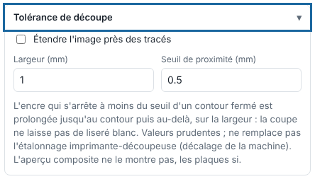

La tolérance de découpe prolonge l'encre qui s'arrête juste avant le contour de découpe, pour masquer un petit décalage de la lame. Cet article s'adresse aux opérateurs.

## Avant de commencer

Le travail s'imprime et se découpe, avec des contours fermés. Réglez d'abord l'étalonnage imprimante-découpeuse : la tolérance ne le remplace pas.

## Étapes

1. Dans le panneau d'envoi, ouvrez le bloc **Tolérance de découpe**.
2. Cochez **Étendre l'image près des tracés**.
3. Réglez le **Seuil de proximité (mm)** : l'encre qui s'arrête à moins de cette distance d'un contour fermé est prolongée jusqu'au contour.
4. Réglez la **Largeur (mm)** (0,1 à 10 mm) : l'encre est prolongée au-delà du contour sur cette largeur.

   
5. Cliquez **Envoyer au RIP**.
6. Contrôlez les plaques dans la visionneuse.

## Bon à savoir

- L'aperçu composite ne montre pas l'extension, les plaques si.
- Gardez des valeurs prudentes.
- Pour un travail déjà rendu, rouvrez les **Réglages** et refaites le rendu.

## Voir aussi

- [Mettre un travail en coupe](rip-mettre-en-coupe-un-travail.md)
- [Corriger une découpe décalée par rapport à l'impression](../rip-depannage/rip-decoupe-decalee.md)
- [Utiliser la visionneuse pour contrôler un travail](rip-utiliser-la-visionneuse.md)
