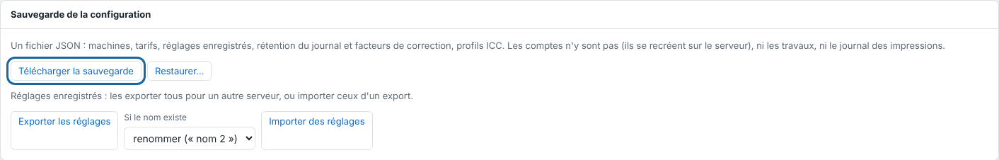

Un réglage enregistré garde tout le panneau d'envoi sous un nom. Cet article montre comment les créer proprement et les transférer vers un autre serveur. Il s'adresse à l'administrateur.

## Avant de commencer

Il vous faut un compte administrateur pour l'export et l'import (**Système** > **Sauvegarde de la configuration**).

## Étapes

1. Pour créer un réglage, cliquez **Importer**, réglez le panneau, puis cliquez **Enregistrer…** à côté de **Réglage** et donnez un nom (lettres, chiffres, espaces, `-`, `_`, `+`). Le choisir dans **Réglage** remplit le panneau ; **Supprimer** le retire.
2. Ouvrez **Administration…**, vue **Système**, section **Sauvegarde de la configuration**.
3. Cliquez **Exporter les réglages** : tous les réglages enregistrés sont téléchargés dans un fichier, pour un autre serveur.
4. Sur l'autre serveur, choisissez **Si le nom existe** : **renommer (« nom 2 »)** ou **écraser**.
5. Cliquez **Importer des réglages** et choisissez le fichier.

   

## Bon à savoir

- Tout est contrôlé avant d'écrire : un fichier invalide n'écrit rien.
- Chaque réglage a un dossier surveillé du même nom (voir [Déposer un fichier dans un dossier surveillé](rip-deposer-un-fichier-dans-un-dossier-surveille.md)).
- Pour garder tout le serveur (réglages, règles, machines), voir [Sauvegarder la configuration du serveur](../rip-administration/rip-sauvegarder-la-configuration.md).

## Voir aussi

- [Déposer un fichier dans un dossier surveillé](rip-deposer-un-fichier-dans-un-dossier-surveille.md)
- [Sauvegarder la configuration du serveur](../rip-administration/rip-sauvegarder-la-configuration.md)
- [Régler le dossier automatique](rip-regler-le-dossier-automatique.md)
