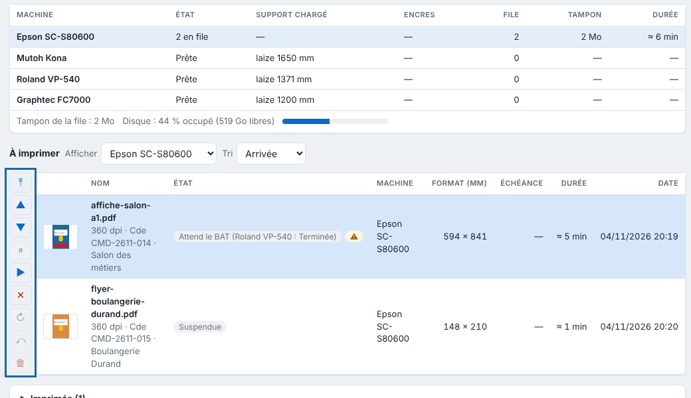
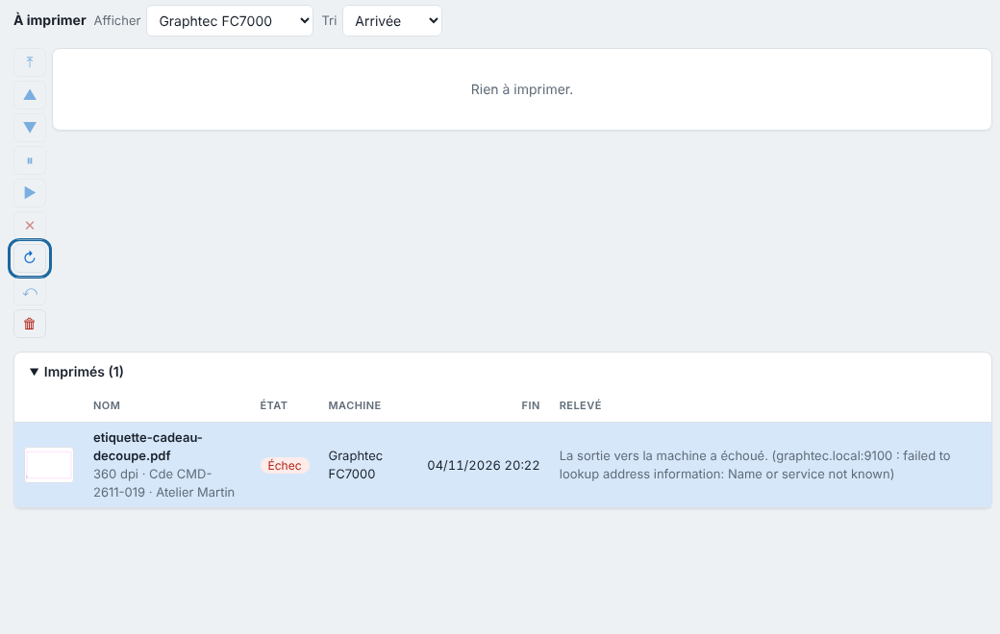

Chaque machine passe une sortie à la fois, dans l'ordre de sa file. Cet article montre comment réordonner la file et lire les raisons d'attente.

## Avant de commencer

Des sorties sont en file (voir [Suivre les travaux et lancer l'impression](rip-suivre-les-travaux.md)). Un compte **Opérateur** suffit.

## Étapes

1. Ouvrez la file de la machine : cliquez son nom dans le tableau des machines (vue **Production**), dans la barre latérale ou dans la vue **File d'attente** des clients.
2. Cliquez la sortie à traiter.
3. Pour changer l'ordre, cliquez **En tête**, **Monter** ou **Descendre**. Vous pouvez aussi glisser une sortie en attente à la place d'une autre de la même machine.

   
4. Pour la mettre de côté, cliquez **Suspendre** ; les suivantes passent devant elle. Cliquez **Reprendre** pour la libérer.
5. Pour l'abandonner, cliquez **Annuler**.
6. Pour la repasser, ouvrez **Imprimés** (l'**Historique** dans les clients) et cliquez **Refaire** : la même sortie repart sans refaire le rendu.

   
7. Pour nettoyer l'historique, cliquez **Retirer**.

## Bon à savoir

Une sortie qui ne peut pas partir affiche un badge rouge (le survol donne le détail) et laisse passer les suivantes (détail : [Comprendre les raisons d'attente d'une sortie](rip-comprendre-les-raisons-d-attente-d-une-sortie.md)) :

- **Machine injoignable** : elle part dès que la machine répond ;
- **Fichier manquant** : relancez le travail ;
- **Trop large** : la page, repères compris, dépasse la laize de la machine ou du rouleau chargé ;
- **Autre support** : elle part d'elle-même quand le bon support est chargé ;
- **Impression pas finie** : une découpe attend la fin de l'impression de sa page ;
- **Découpeuse indisponible** : l'impression attend, pour ne pas gâcher d'encre ;
- **En imbrication** : l'impression attend sa planche ;
- **Page exclue** : la case **Imprimer cette page** est décochée.

Chaque impression à passer affiche sa **durée estimée**, et l'en-tête de la colonne le total restant ; la fiche du travail aussi. Estimation : longueur imprimée × laize de la machine ÷ cadence. Cadence de l'Epson par défaut : 94 m²/h jusqu'à 360 dpi, 17 m²/h à 720 dpi (720 × 1440, 6 passes), 6,6 m²/h au-delà. Quand une sortie se termine ou échoue, l'écran le dit, et le système aussi si le client a l'autorisation d'afficher des notifications.

Les tons de découpe (`CutContour`…) ne partent jamais à l'imprimante. Pour une Epson en connexion **Dossier**, rien n'est imprimé : la sortie finie s'affiche **Déposée dans le dossier (pas imprimée)** (voir [Comprendre le pilote direct de l'Epson](../rip-machines/rip-comprendre-le-pilote-direct-de-l-epson.md)). La découpe du Kona part par le port du plotter (`/dev/kona`).

Chaque impression affiche sa durée estimée. Pour l'ajuster, mesurez la cadence réelle et saisissez-la en **Cadence (m²/h)** de la machine. Une sortie coupée par un arrêt du serveur passe en *Échec* : **Refaire** la relance. L'**Archive** garde les découpes archivées, que **Restaurer** remet en file.

## Voir aussi

- [Créer une planche pour regrouper des impressions](rip-creer-une-planche.md)
- [La sortie vers la machine a échoué](../rip-depannage/rip-sortie-vers-la-machine-echouee.md)
- [Comprendre les raisons d'attente d'une sortie](rip-comprendre-les-raisons-d-attente-d-une-sortie.md)
- [Ajouter une machine au RIP](../rip-machines/rip-ajouter-une-machine.md)
